# Assignment 1

**Meno:** Ákos Kappel

**Predmet:** Počítačová videnie

**Cvičenie:** Pondelok 11:00

**Cvičiaci:** Ing. Marek Jakab, PhD.

**Použité knižnice:** OpenCV, Matplotlib, Numpy

**Dôležité metódy:**
imread,
resize,
cvtColor,
split,
calcHist,
GaussianBlur,
medianBlur,
blur,
bilateralFilter,
threshold,
adaptiveThreshold,
morphologyEx,
dilate,
erode,
findContours,
drawContours,
bitwise_not,
watershed,
distanceTransform,
connectedComponents

## Obrázok 1 - Bublinky v pive

Ako prvý obrázok som si vybral bublinky v pive.
Celý postup segmentácie bubliniek a ich spočítanie je v súbore *[beer_bubbles.ipynb](beer_bubbles.ipynb)*.

### 1. Načítanie obrázku

Na začiatok som nažítal obrázok pomocou funkcie `cv2.imread()`, ktorá nám vráti maticu pixelov obrázku.
Následne som sa rozhodol obrázok zmenšiť, keďže pôvodný obrázok mal veľké rozmery.
Na zmenšenie obrázku som použil funkciu `cv2.resize()`.

```python
# load image from file
file = 'images/pena.tif'
img = cv.imread(file)

# resize image if needed
scaling = 0.3
img = cv.resize(img, (0, 0), fx=scaling, fy=scaling)
```

**Pôvodný obrázok po načítaní a zmenšení:**

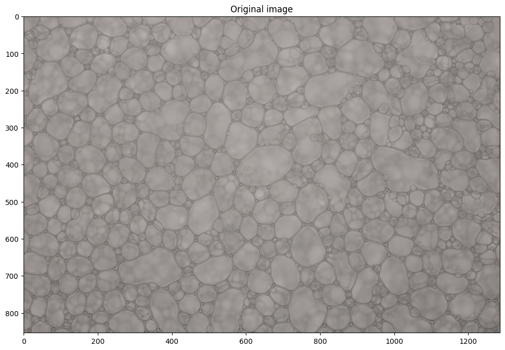

### 2. Analýza

Analýzu som začal konvertovaním farebného obrázku do šedotónového obrázku.
Zároveň som rozdelil obrázok na jednotlivé RGB kanály, aby som mohol pozrieť, ktorý z nich je najviac vhodný na ďalšie
spracovanie.

```python
# convert image to grayscale
gray = cv.cvtColor(img, cv.COLOR_BGR2GRAY)

# split RGB channels
b, g, r = cv.split(img)

# create histograms for each channel
hist_r = cv.calcHist([r], [0], None, [256], [0, 256])
hist_g = cv.calcHist([g], [0], None, [256], [0, 256])
hist_b = cv.calcHist([b], [0], None, [256], [0, 256])
```

Ako to môžeme vidieť na nasledovných grafoch, všetky štyri výstupy sú si veľmi podobné.
Pri výbere vhodného kanálu som si pomohol aj zobrazením histogramov pre jednotlivé kanály.
Histogramy však potvrdil že všetky kanály sú skoro identické, a preto som sa rozhodol ďalej pracovať len so šedotónovým
obrázkom.

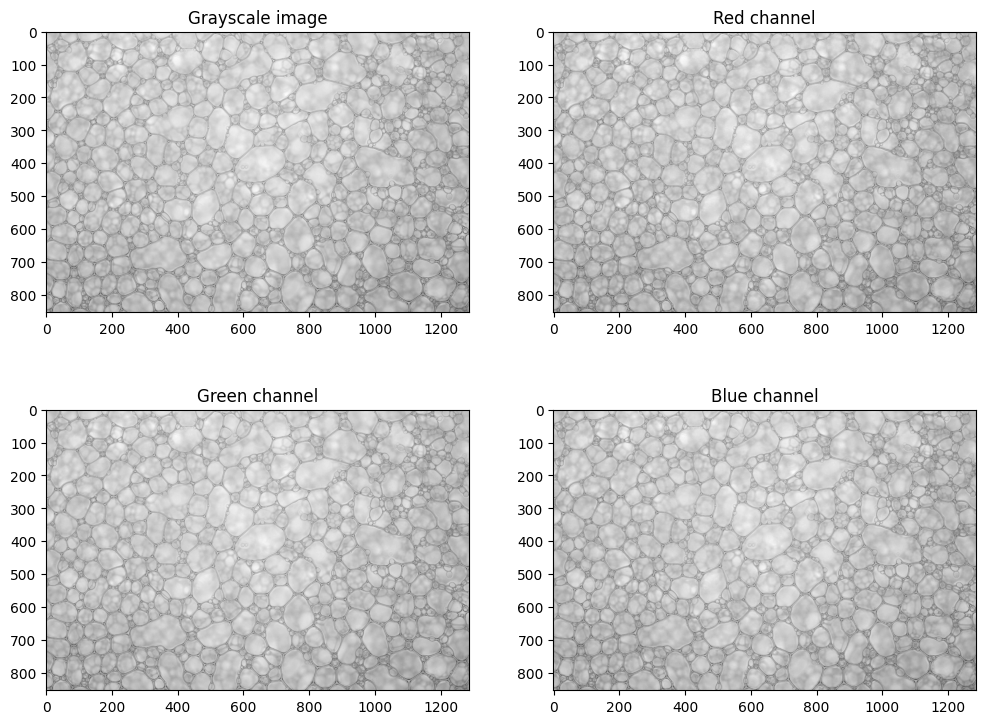

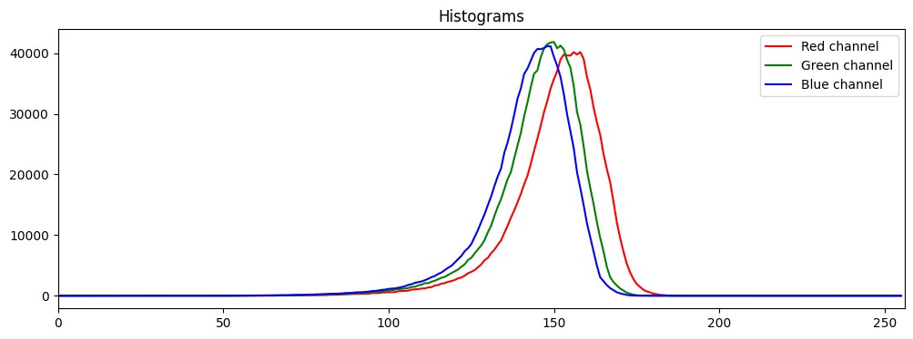

### 3. Preprocessing

#### 3.1. Odstránenie šumu

Predspracovanie obrázku som začal experimentovaním s rôznymi metódami rozmazania obrázku.
Pri väčšine rozmazaní sa zdal byť najvhodnejší kernel veľkosti *5x5*.

```python
gauss = cv.GaussianBlur(gray, (5, 5), 0)
median = cv.medianBlur(gray, 5)
mean = cv.blur(gray, (5, 5))
bilateral = cv.bilateralFilter(gray, 9, 75, 75)
```

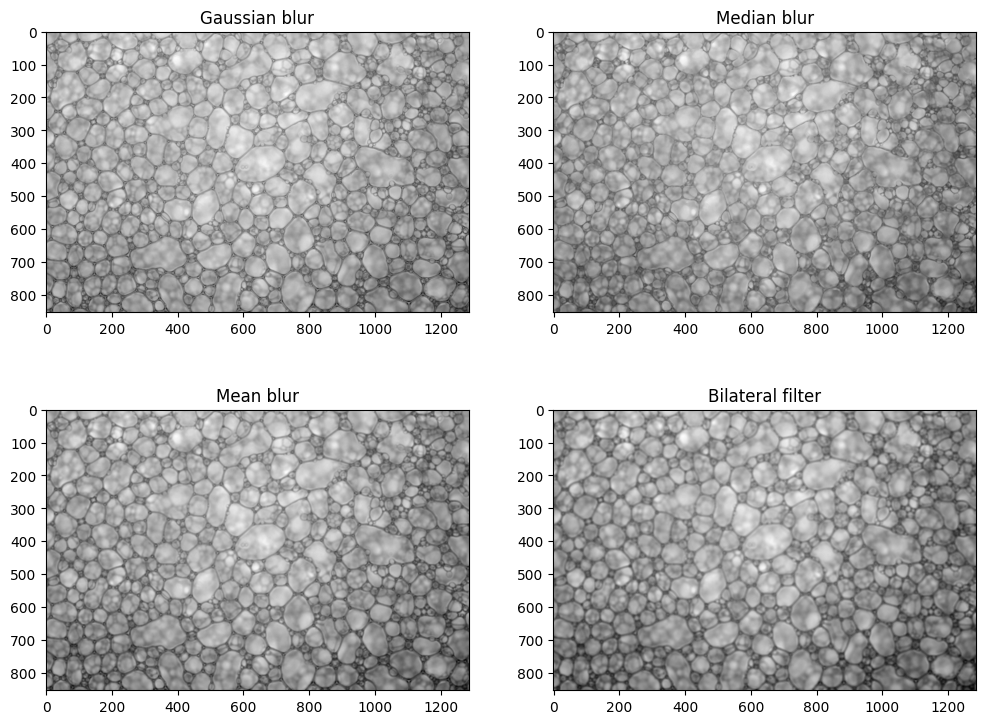

#### 3.2. Binarizácia

Ďalej som pokračoval binarizáciou obrázku.
Na prahovanie som použil metódu OTSU a aj adaptívne prahovanie.
Metóda OTSU nebola pre tento obrázok vhodná, pretože spôsobovala problémy, najmä v pravej a dolnej časti obrázku, kde sa
vytvorili čierne škvrny.
Adaptívne prahovanie však fungovalo veľmi dobre a výsledok bol lepší ako pri OTSU.
Adaptívne prahovanie som si vyskúśal na všetkých štyroch rozmazaných obrázkoch a následne som si vybral najlepší
výsledok, ktorým sa zdal byť obrázok rozmazaný pomocou metódy *Gaussian Blur*.
Pri tomto obrázku sú hrany najvýraznejšie a na pozadí sa vyskytuje najmenej čiernych bodov.

Parametre pre funkciu `cv2.threshold()` sú nasledovné:

* `gray` - vstupný obrázok
* `0` - hodnota prahovania
* `255` - maximálna hodnota prahovania
* `cv.THRESH_BINARY + cv.THRESH_OTSU` - typ prahovania

Parametre pre funckiu `cv2.adaptiveThreshold()`:

* `gray` - vstupný obrázok
* `255` - maximálna hodnota prahovania
* `cv.ADAPTIVE_THRESH_GAUSSIAN_C` - metóda adaptívneho prahovania (*Gaussian* alebo *Mean*)
* `cv.THRESH_BINARY` - typ prahovania
* `11` - veľkosť okolia, ktoré sa použije pri adaptívnom prahovani
* `2` - konštantná hodnota, ktorá sa odčíta z výsledku adaptívneho prahovania

```python
# OTSO threshold
ret, otsu_thresh = cv.threshold(gauss, 0, 255, cv.THRESH_BINARY + cv.THRESH_OTSU)

# adaptive threshold
gray_thresh = cv.adaptiveThreshold(gray, 255, cv.ADAPTIVE_THRESH_GAUSSIAN_C, cv.THRESH_BINARY, 11, 2)
gauss_thresh = cv.adaptiveThreshold(gauss, 255, cv.ADAPTIVE_THRESH_GAUSSIAN_C, cv.THRESH_BINARY, 11, 2)
median_thresh = cv.adaptiveThreshold(median, 255, cv.ADAPTIVE_THRESH_GAUSSIAN_C, cv.THRESH_BINARY, 11, 2)
mean_thresh = cv.adaptiveThreshold(mean, 255, cv.ADAPTIVE_THRESH_GAUSSIAN_C, cv.THRESH_BINARY, 11, 2)
bilateral_thresh = cv.adaptiveThreshold(bilateral, 255, cv.ADAPTIVE_THRESH_GAUSSIAN_C, cv.THRESH_BINARY, 11, 2)
```

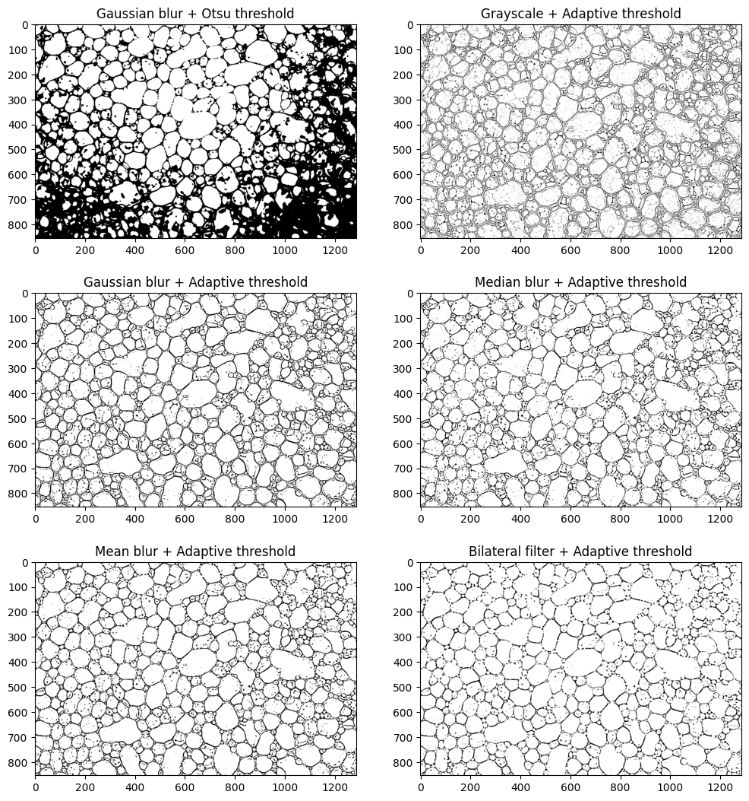

#### 3.3. Morphologické operácie

Následne som použil morfologické operácie na odstránenie nežiadaných objektov z obrázku.
Veľkosť kernelu som nastavil na *3x3* pretoźe väčšie rozmery príliš ovplyvňili obrázok, napríklad tým, že zmazali
niektoré hrany.
Pre počet iterácií sa ukázalo, že je vhodné použiť iba jednu alebo maximálne dve iterácie.

```python
# use image with adaptive threshold on gaussian blur
thresh = gauss_thresh

# parameters for morphological operations
kernel = cv.getStructuringElement(cv.MORPH_ELLIPSE, (3, 3))
iterations = 1

# morphological operations
erosion = cv.erode(thresh, kernel, iterations=iterations)
dilation = cv.dilate(thresh, kernel, iterations=iterations)
opening = cv.morphologyEx(thresh, cv.MORPH_OPEN, kernel, iterations=iterations)
closing = cv.morphologyEx(thresh, cv.MORPH_CLOSE, kernel, iterations=iterations)
```

Parametre pre funkcie `cv2.erode()` a `cv2.dilate()`:

* `thresh` - vstupný obrázok
* `kernel` - kernel s veľkosťou *3x3*, s ktorým sa bude obrázok rozmazávať
* `iterations` - počet iterácií rozmazávania

Pre funkciu `cv2.morphologyEx()` pribudol ďalší parameter `op`, ktorý určuje typ morfologického operátoru.

**Ukážka štyroch vyskúšaných morfologických operácií:**

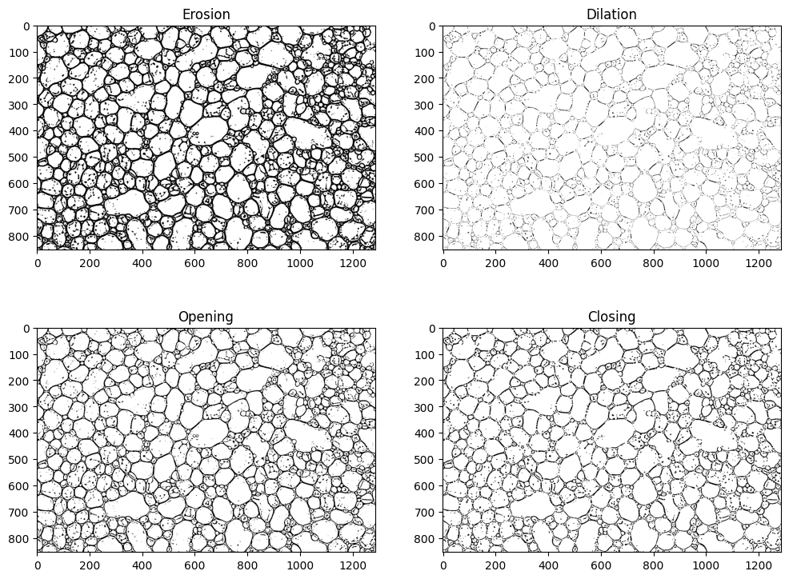

Vhodným poradím na riešenie úlohy bolo použiť operáciu **opening** a následne **erosion**.
Pre vytvorenie kernelu som použil parameter `cv2.MORPH_ELLIPSE`, ktorým som získal lepšie výsledky ako s obyčajnýn
štvorcovým kernelom.

```python
# apply morphological opening
kernel = cv.getStructuringElement(cv.MORPH_ELLIPSE, (3, 3))
opening = cv.morphologyEx(thresh, cv.MORPH_OPEN, kernel, iterations=1)

# apply morphological erosion
kernel = cv.getStructuringElement(cv.MORPH_ELLIPSE, (3, 3))
eroded = cv.erode(opening, kernel, iterations=1)
```

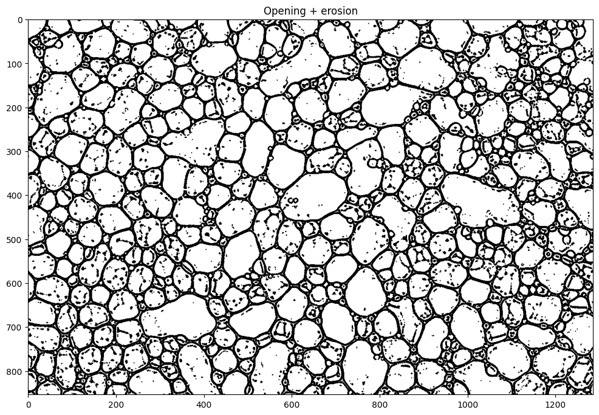

Keďže výsledný obrázok ešte stále obsahoval nežiadané objekty, vyskúšal som použiť filtrovanie s vlastným kernelom.
Ako kernel som použil maticu s veľkosťou *3x3*, ktorá obsahovala hodnoty *-1* okrem stredného prvku, ktorý mal hodnotu
*9*.
Takáto matica má za účel zaostriť obrázok a tým viac zvýrazniť hrany.
Potom som na zaostrenom obraze použil rovnaké morfologické operácie, ako pri predchádzajúcom kroku, ale tentokrát som
dosiahol lepší výsledný obrázok.

```python
kernel = np.array([
    [-1, -1, -1],
    [-1, 9, -1],
    [-1, -1, -1],
])
sharp = cv.filter2D(gray, -1, kernel)
```

Parametre funkcie `cv2.filter2D()`:

* `gray` - vstupný obrázok
* `-1` - hĺbka výsledného obrázku (v prípade, že je nastavená na -1, tak sa použije hĺbka vstupného obrázku)
* `kernel` - vlastný kernel

**Výsledok po filtrovaní vlastným kernelom:**

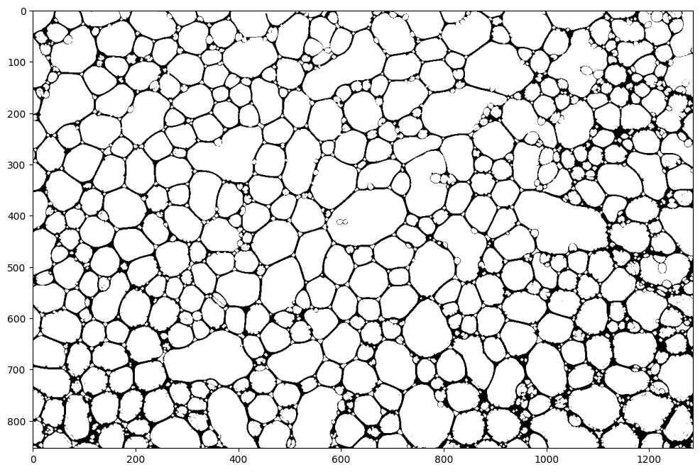

### 4. Detekcia kontúr

Na detekciu kontúr som použil function `cv2.findContours()`.
Následne nájdené kontúry som filtroval podľa minimálnej požadovanej veľkosti a nakoniec som ich vykreslil do obrázku.

```python
# find contours
contours, hierarchy = cv.findContours(eroded, cv.RETR_EXTERNAL, cv.CHAIN_APPROX_SIMPLE)

# filter small contours
min_size = 10
contours = [c for c in contours if cv.contourArea(c) > min_size]

# show contours in image
cont_img = cv.drawContours(img.copy(), contours, -1, (255, 0, 0), 2)
```

Parametre funkcie `cv2.findContours()`:

* `eroded` - vstupný obrázok
* `cv.RETR_EXTERNAL` - metóda detekcie kontúr (v tomto prípade sa detekujú iba kontúry vonkajších objektov)
* `cv.CHAIN_APPROX_SIMPLE` - metóda aproximácie kontúr

Parametre funkcie `cv2.contourArea()`:

* `c` - kontúra, ktorej veľkosť chceme zistiť

Parametre funkcie `cv2.drawContours()`:

* `img.copy()` - vstupný obrázok
* `contours` - zoznam kontúr, ktoré chceme vykresliť
* `-1` - index kontúry, ktorú chceme vykresliť (v prípade, že je nastavená na -1, tak sa vykreslia všetky kontúry)
* `(255, 0, 0)` - farba kontúr
* `2` - hrúbka kontúr

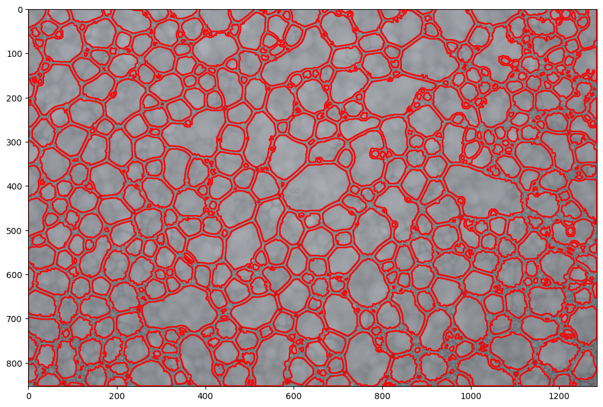

Podarilo sa celkom pekne detekovať kontúry bubliniek, ale v pravej časti obrázku, kde sa nachádza vedľa seba veľa malých
bubliniek, sa niektoré nezapočítali.
Preto som skúsil ešte jeden postup, pri ktorom som na začiatku predspracovania spravil rozdiel medzi šedotónovým
obrázkom a obrázkom ktorý vznikol vlastným kernelom.

```python
# subtract sharp image from grayscale image
sub = cv.subtract(gray, sharp)

# dilate image
kernel = np.ones((3, 3), np.uint8)
dilation = cv.dilate(sub, kernel, iterations=1)

# use OTSU threshold on dilated image
_, thresh = cv.threshold(dilation, 0, 255, cv.THRESH_BINARY_INV + cv.THRESH_OTSU)

# apply opening
kernel = cv.getStructuringElement(cv.MORPH_ELLIPSE, (3, 3))
opening = cv.morphologyEx(thresh, cv.MORPH_OPEN, kernel, iterations=2)
```

[//]: # (**Medzivýsledky predspracovania obrázku:**)

[//]: # ()

[//]: # (![Full process]&#40;out/pena_process.png&#41;)

Spôsob hľadania kontúr som nechal rovnaký.
Ukázalo sa, že vďaka vykonanej úprave sa podarilo detekovať aj niekotré malé bubliny, ktoré boli predtým vynechané.

**Výsledok finálneho spracovania obrázku:**

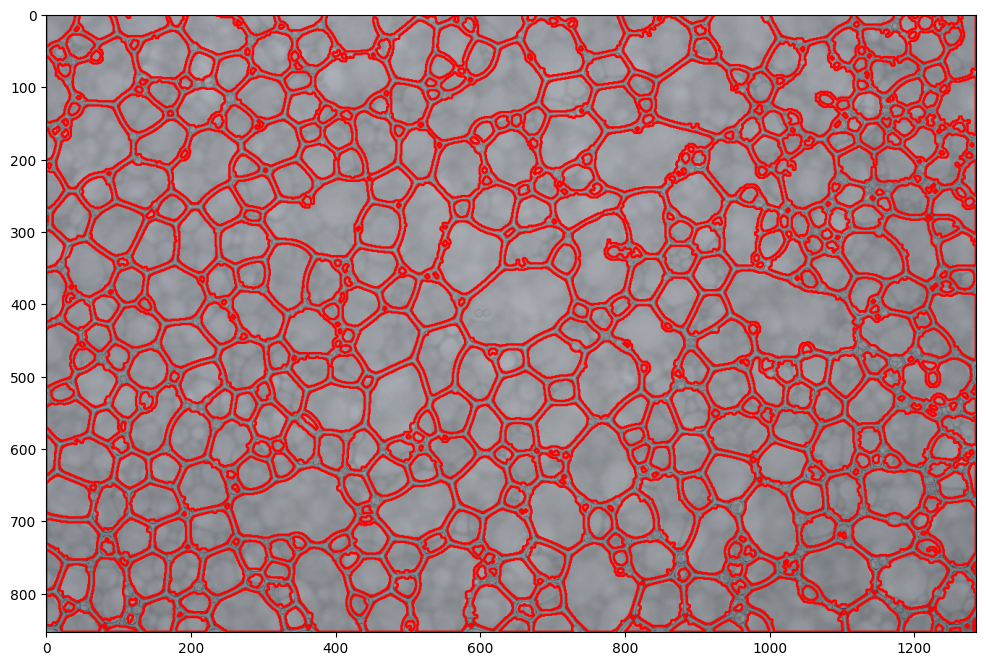

Výsledný počet bubliniek mi vyšiel ***624***.

## Obrázok 2 - Bunky rakoviny

Pre druhý obrázok som vybral obrázok s rakovinovými bunkami.
Celý kód postupu segmentácie buniek je v súbore *[breast_cancer.ipynb](breast_cancer.ipynb)*.

### 1. Načítanie obrázku

Načítanie a zmenšenie obrázku prebiehalo rovnako ako pri prvom obrázku.

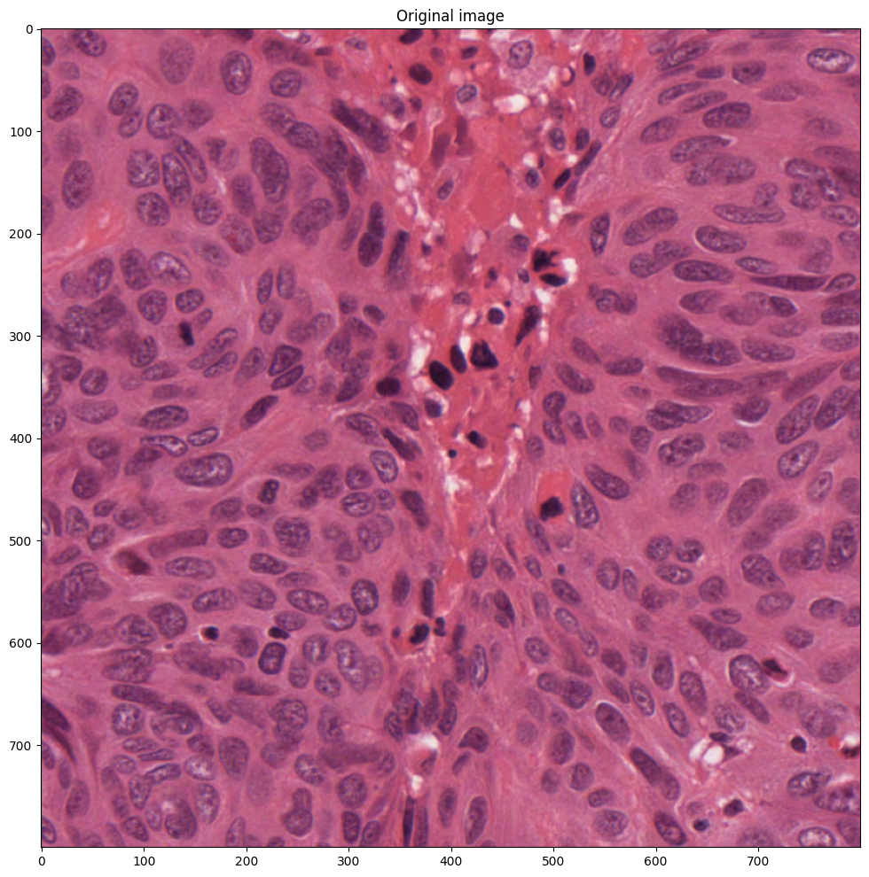

### 2. Analýza

Analýzu som opäť zažal rozdelením obrázku na jednotlivé kanály, aby som zistil, ktorý z nich je najvhodnejší na
segmentáciu.
Pri tomto obrázku sa ukázalo, že najvýraznejší rozdiel medzi bunkami a pozadím je v červenom kanáli.

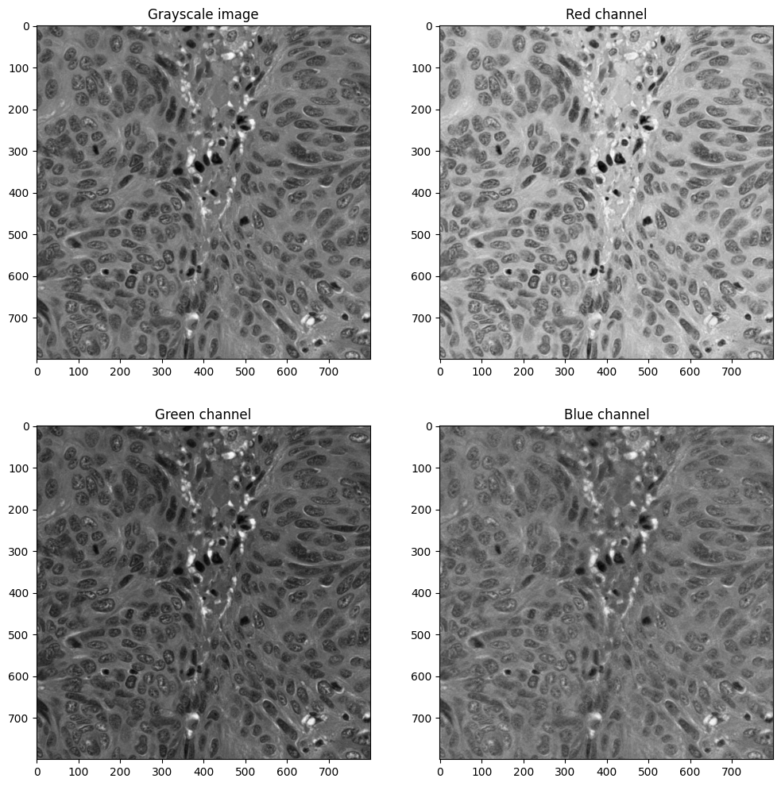

Výber červeného kanálu som potrvrdil aj histogramom, na ktorom je vidieť, že červený kanál by vedel pekne rozdeliť
obrázok okolo hodnoty *160*.

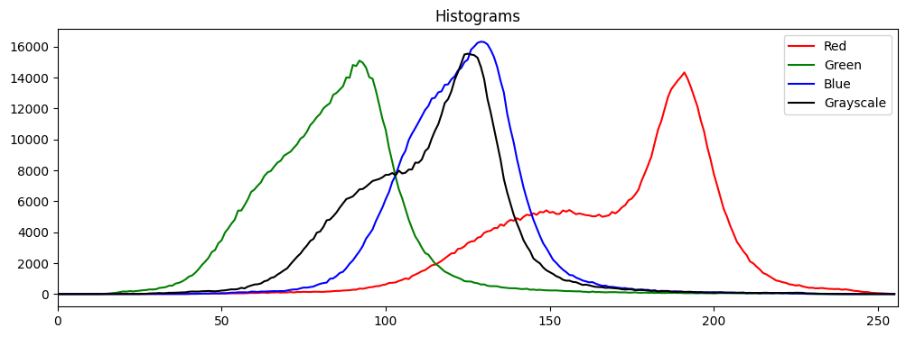

Skúsil som porovnať aj HSV kanály, ale nepodarilo sa získať lepšie rozdelenie hodnôt ako pri RGB kanáloch.

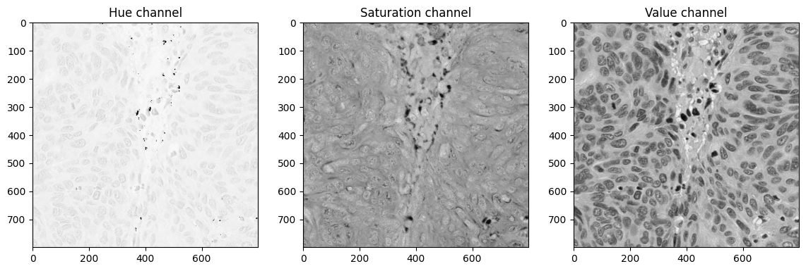

### 3. Preprocessing

#### 3.1. Odstránenie šumu

Na odstránenie šumu som vyskúšal štyri rôzne metódy: *mean filter*, *median blur*, *gaussian blur* a *bilateral filter*.
Najlepšie výsledky som získal pri použití metódy *median blur* s veľkosťou kernelu *5x5*.

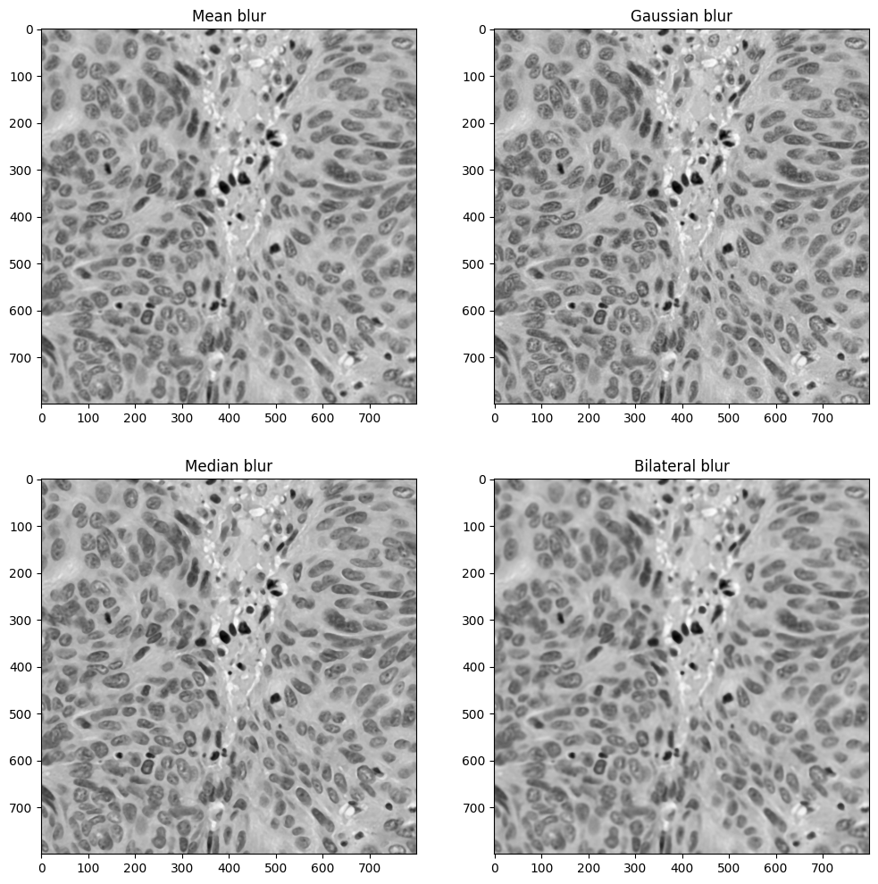

#### 3.2. Binarizácia

Na binarizáciu obrázku som použil dve metódy: *OTSU thresholding* a *adaptive thresholding*.
Na rozdiel od prvého obrázku, kde sa mi podarilo dosiahnuť lepšie výsledky pri použití *adaptive thresholding*, pri
tomto obrázku som dosiahol lepšie výsledky pri metóde *OTSU thresholding*.
Avšak aj pri tejto metóde vznikli malé chyby.
Najmä také, že bunky, ktoré boli blízko seba, sa spojili do jednej veľkej bunky.
Tento jav môžeme vidieť napríklad v ľavej hornej časti obrázku.

```python
# blur image
blur = cv.GaussianBlur(r, (5, 5), 0)

# OTSU thresholding
ret, otsu_thresh = cv.threshold(blur, 0, 255, cv.THRESH_BINARY + cv.THRESH_OTSU)

# Adaptive thresholding
adap_thresh = cv.adaptiveThreshold(blur, 255, cv.ADAPTIVE_THRESH_GAUSSIAN_C, cv.THRESH_BINARY, 175, 2)
```

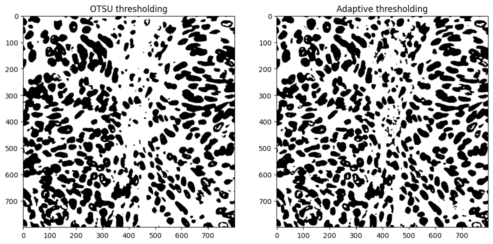

#### 3.3. Morfologické operácie

Pomocou morfologických operácií som sa snažil odstrániť chyby, ktoré vznikli pri binarizácii.
Na začiatku som použil operáciu *morphological closing*, ktorá odstránila malé fragmenty z pozadia.
Následne som použil operáciu *dilate*, ktorou som sa snažil spojené bunky rozdeliť.
Nakoniec som aplikoval *morphological opening*, ktorá odstránila malé bodky z povrchu buniek.

Parametre funkcie `cv2.getStructuringElement()`:

* `cv.MORPH_ELLIPSE` - elipsoidný štruktúrovací prvok
* `cv.MORPH_RECT` - obdĺžnikový štruktúrovací prvok
* `(3, 3)` - veľkosť kernelu

```python
# morphological closing
kernel = cv.getStructuringElement(cv.MORPH_ELLIPSE, (3, 3))
closing = cv.morphologyEx(thresh, cv.MORPH_CLOSE, kernel)

# dilate image
kernel = cv.getStructuringElement(cv.MORPH_RECT, (3, 3))
dilate = cv.dilate(closing, kernel, iterations=1)

# morphological opening
kernel = cv.getStructuringElement(cv.MORPH_RECT, (3, 3))
opening = cv.morphologyEx(dilate, cv.MORPH_OPEN, kernel, iterations=2)
```

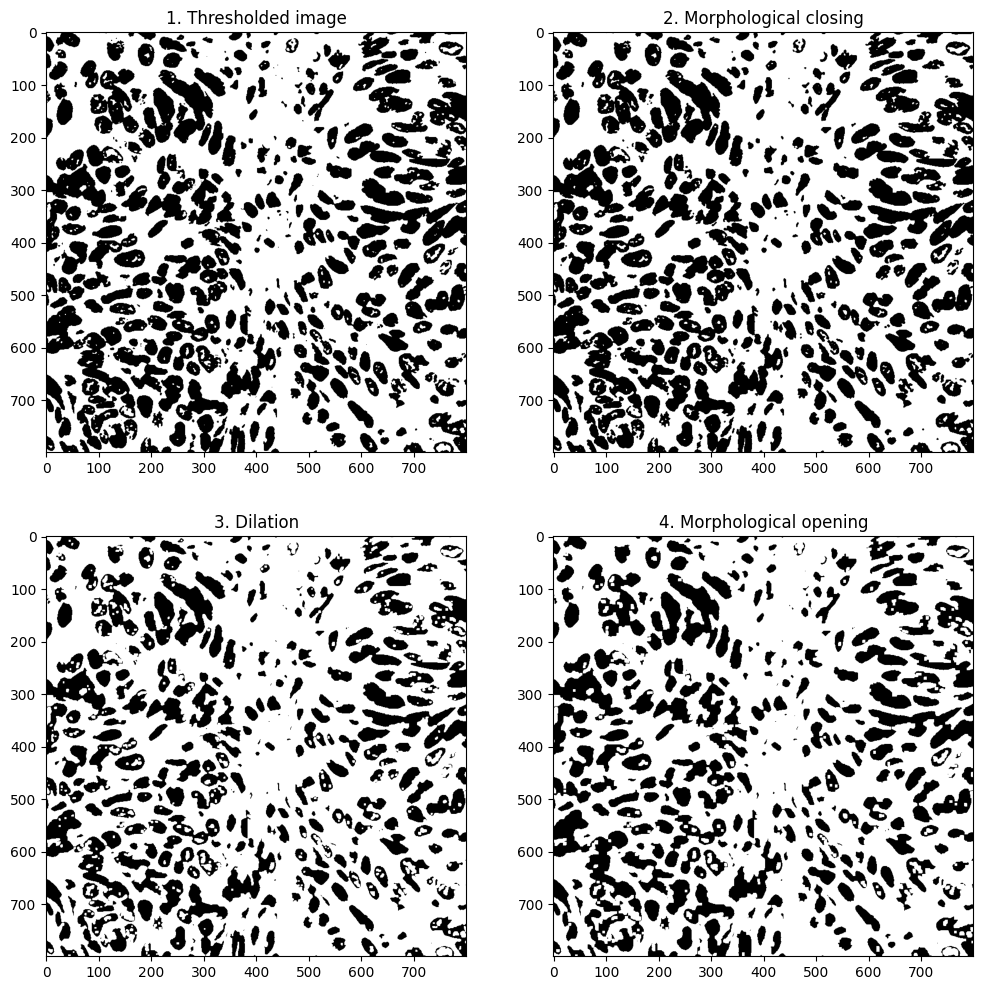

### 4. Detekcia kontúr

Pred detekciou kontúr som potreboval invertnúť obrázok, aby som mohol detekovať biele bunky na čierom pozadí.
Potom som použil metódu `cv2.findContours()` na nájdenie kontúr.
Nakoniec som prefiltroval nájdené kontúry podľa veľkosti a nakreslil som ich na pôvodný obrázok.

```python
# invert image
inverted = cv.bitwise_not(dilate)

# find contours
contours, hierarchy = cv.findContours(inverted, cv.RETR_EXTERNAL, cv.CHAIN_APPROX_SIMPLE)

# filter contours
contours = [c for c in contours if cv.contourArea(c) > 100]

# draw contours
contour_img = img.copy()
cv.drawContours(contour_img, contours, -1, (0, 255, 0), 1)
```

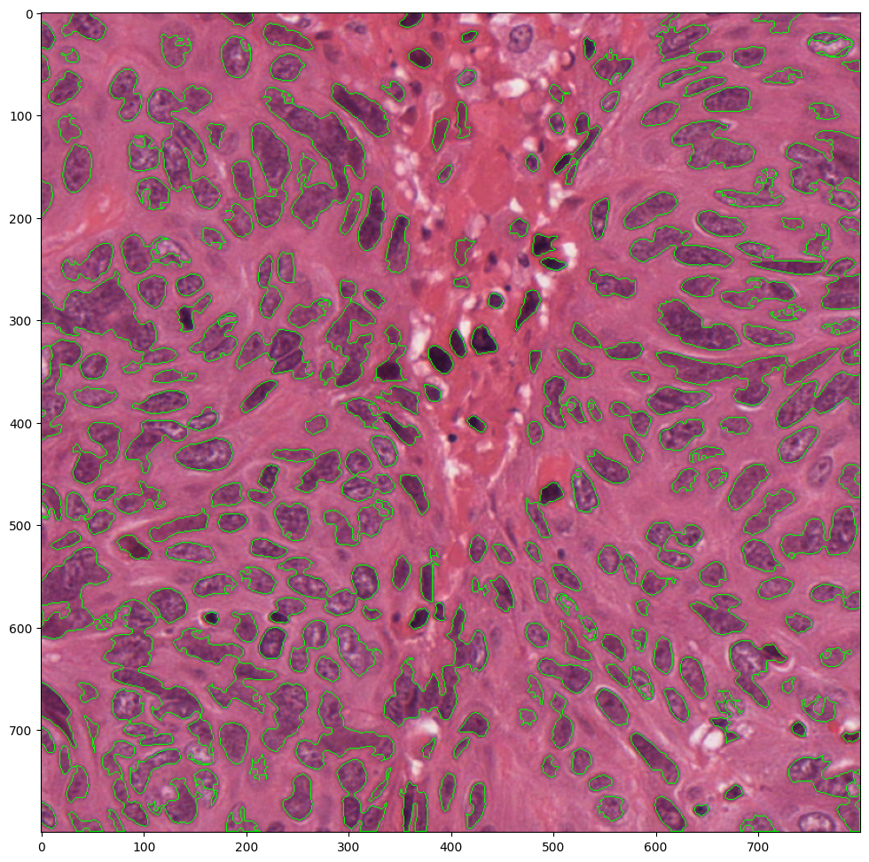

Výsledný počet nájdených buniek mi vyšiel ***247***.

### Metóda watershed

Pri tomto obrázku som si vyskúšal aj druhý spôsob na spočítanie buniek, a to metódu *Watershed*.
Na začiatok som spravil *OTSU thresholding* na červenom kanáli a binarizovaný obraz som upravil morfologickými
operáciami.
Potom som oblasti obrazu rozdelil na tri regióny: pozadie, popredie a neznáma časť.
Pozadie som zistil tak, že som na binarizovaný obraz aplikoval diláciu, aby som zvýšil plochy buniek, a pre pozadie som
zvolil tie body, ktoré mali aj po dilácii hodnotu 0.
Na zistenie popredia som použil funkciu `cv2.distanceTransform()`, ktorá vypočíta vzdialenosť od každého bodu k
najbližšiemu bodu s hodnotou 0.
Následne som na vypočítané vzdialenosti aplikoval funkciu `cv2.normalize()`, pomocou ktorej som normalizoval hodnoty do
intervalu [0, 1] a pre popredie som zvolil tie body, ktoré mali hodnotu väčšiu ako 0.2.
Ako neznámu časť som zvolil oblasti, ktoré neboli ani pozadie ani popredie.
Potom som z detekovaného popredia vytvoril značky, ktoré som použil ako vstup pre funkciu `cv2.watershed()`.

```python
# Otsu's thresholding on red channel
_, otsu = cv.threshold(r, 0, 255, cv.THRESH_BINARY_INV + cv.THRESH_OTSU)

# morphological operations
kernel = cv.getStructuringElement(cv.MORPH_ELLIPSE, (3, 3))
opening = cv.morphologyEx(otsu, cv.MORPH_OPEN, kernel, iterations=2)

# find sure background area
sure_bg = cv.dilate(opening, kernel, iterations=5)

# create distance transform
dist = cv.distanceTransform(opening, cv.DIST_L2, 5)
cv.normalize(dist, dist, 0, 1.0, cv.NORM_MINMAX)

# find sure foreground area
_, sure_fg = cv.threshold(dist, 0.2 * dist.max(), 255, 0)

# find unknown region
sure_fg = np.uint8(sure_fg)
unknown = cv.subtract(sure_bg, sure_fg)

# marker labelling
_, markers = cv.connectedComponents(sure_fg)

# add one to all labels so that sure background is not 0, but 1
markers = markers + 1
# mark the region of unknown with zero
markers[unknown == 255] = 0

# apply watershed
markers = cv.watershed(img, markers)
watershed_img = img.copy()
watershed_img[markers == -1] = [0, 255, 0]
```

Parametre funkcie `cv2.distanceTransform()`:

* `image` - vstupný obrázok
* `distanceType` - typ vzdialenosti (cv2.DIST_L2, cv2.DIST_L1)
* `maskSize` - veľkosť masky

Parametre funkcie `cv2.normalize()`:

* `src` - vstupný obrázok
* `dst` - výstupný obrázok
* `0` - minimálna hodnota
* `1.0` - maximálna hodnota
* `cv2.NORM_MINMAX` - typ normalizácie

Parametre funkcie `cv2.watershed()`:

* `image` - vstupný obrázok
* `markers` - značky, ktoré určujú regióny, v ktorých sa nachádzajú bunky

Ako to môžme vidieť na dolnom obrázku, metóda *Watershed* nedosiahla podobne dobré výsledky ako predchádzajúca metóda.
Hlavným problémom pri tejto metóde bolo to, že watershed rozdelil mnohé bunky na viacero menších častí a iné zase
naopak, spojil do jedného veľkého celku.
Pre zlepšenie výsledkov som skúsil zmeniť parametre na nájdenie poporedia a pozadia, ale nepodarilo sa mi získať lepšie
segmentovaný obrázok, než ako pri metóde detekovania kontúr.

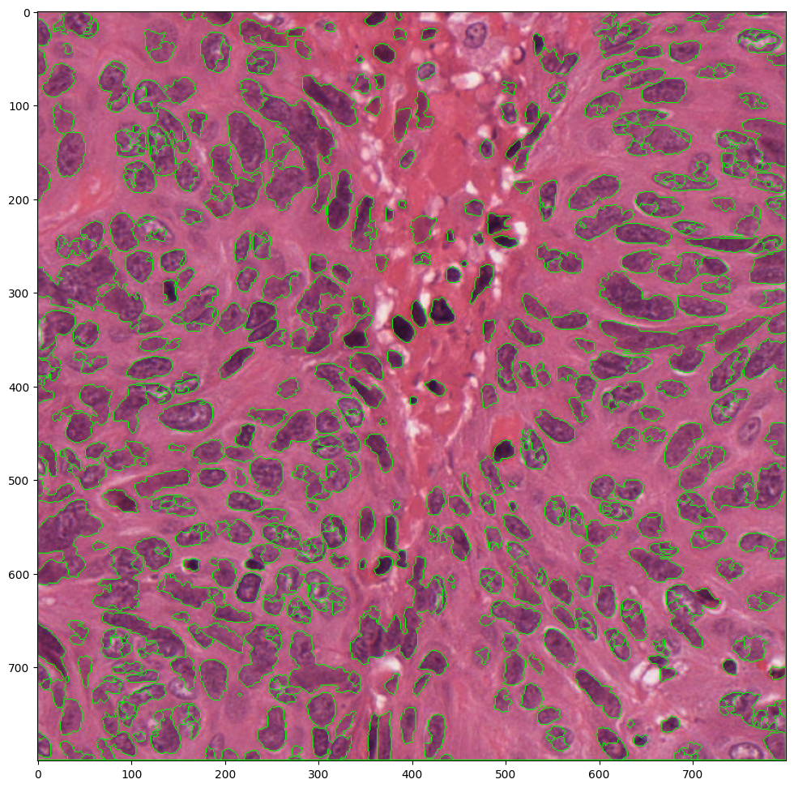

