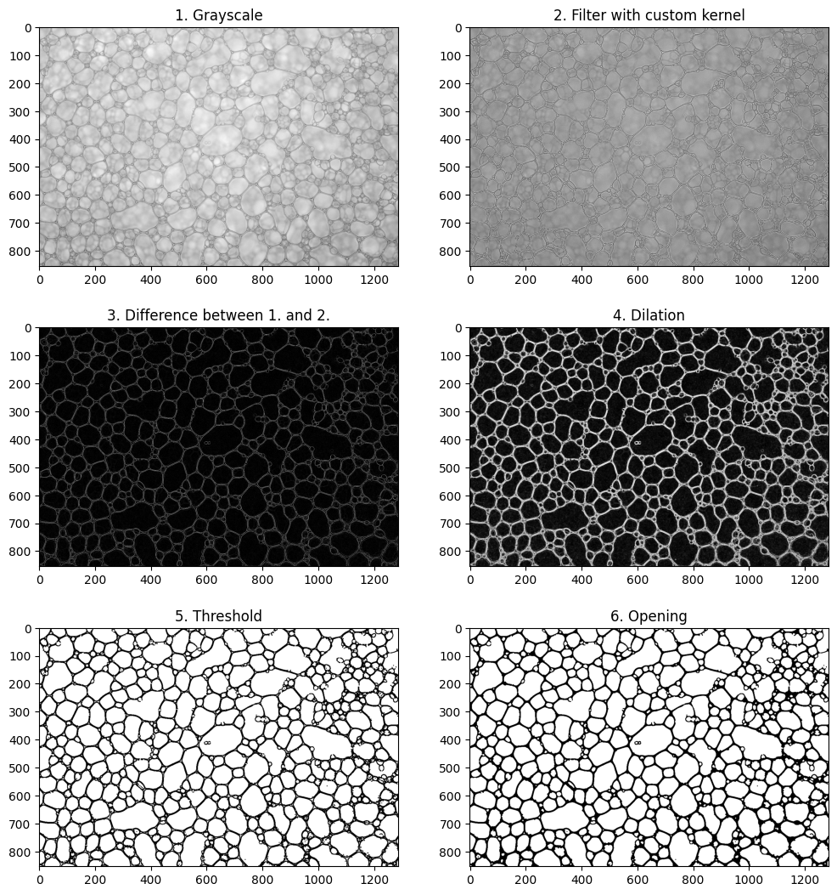

# Assignment 1

Meno: Ákos Kappel

Predmet: Počítačová videnie

Cvičenie: Pondelok 11:00

Cvičiaci: Ing. Marek Jakab, PhD.


## Obrázok 1 - Bublinky v pive

Ako prvý obrázok som si vybral bublinky v pive.
Celý postup segmentácie bubliniek a ich spočítanie je v súbore *[beer_bubbles.ipynb](beer_bubbles.ipynb)*.

### 1. Načítanie obrázku

Na začiatok som nažítal obrázok pomocou funkcie `cv2.imread()`, ktorá nám vráti maticu pixelov obrázku.
Následne som sa rozhodol obrázok zmenšiť, keďže pôvodný obrázok mal veľké rozmery.
Na zmenšenie obrázku som použil funkciu `cv2.resize()`.

```python
# load image from file
file = 'images/pena.tif'
img = cv.imread(file)

# resize image if needed
scaling = 0.3
img = cv.resize(img, (0, 0), fx=scaling, fy=scaling)
```

**Pôvodný obrázok po načítaní a zmenšení:**


### 2. Analýza

Analýzu som začal konvertovaním farebného obrázku do šedotónového obrázku.
Zároveň som rozdelil obrázok na jednotlivé RGB kanály, aby som mohol pozrieť, ktorý z nich je najviac vhodný na ďalšie spracovanie.

```python
# convert image to grayscale
gray = cv.cvtColor(img, cv.COLOR_BGR2GRAY)

# split RGB channels
b, g, r = cv.split(img)

# create histograms for each channel
hist_r = cv.calcHist([r], [0], None, [256], [0, 256])
hist_g = cv.calcHist([g], [0], None, [256], [0, 256])
hist_b = cv.calcHist([b], [0], None, [256], [0, 256])
```

Ako to môžeme vidieť na nasledovných grafoch, všetky štyri výstupy sú si veľmi podobné.
Pri výbere vhodného kanálu som si pomohol aj zobrazením histogramov pre jednotlivé kanály, ktorý však potvrdil že všetky kanály sú skoro identické.
Rozhodol som sa teda ďalej pracovať so šedotónovým obrázkom.


### 3. Preprocessing

#### 3.1. Odstránenie šumu

Predspracovanie obrázku som začal experimentovaním s rôznymi metódami rozmazania obrázku.
Pri väčšine rozmazaní sa zdal byť najvhodnejší kernel veľkosti *5x5*.

```python
gauss = cv.GaussianBlur(gray, (5, 5), 0)
median = cv.medianBlur(gray, 5)
mean = cv.blur(gray, (5, 5))
bilateral = cv.bilateralFilter(gray, 9, 75, 75)
```


#### 3.2. Binarizácia

Ďalej som pokračoval binarizáciou obrázku.
Na prahovanie som použil metódu Otsu a aj adaptívne prahovanie.
Metóda Otsu nebola pre tento obrázok vhodná, pretože spôsobovala problémy, najmä v pravej a dolnej časti obrázku, kde sa vytvorili čierne škvrny.
Adaptívne prahovanie však fungovalo veľmi dobre a výsledok bol lepší ako pri Otsu.
Túto metódu som si vyskúśal na všetkých štyroch rozmazaných obrázkoch a následne som si vybral najlepší výsledok, ktorým sa zdal byť obrázok rozmazaný pomocou metódy Gaussian Blur.
Pri tomto obrázku sú hrany najvýraznejšie a na pozadí sa vyskytuje najmenej čiernych bodov.

```python
# OTSO threshold
ret, otsu_thresh = cv.threshold(gauss, 0, 255, cv.THRESH_BINARY + cv.THRESH_OTSU)

# adaptive threshold
gray_thresh = cv.adaptiveThreshold(gray, 255, cv.ADAPTIVE_THRESH_GAUSSIAN_C, cv.THRESH_BINARY, 11, 2)
gauss_thresh = cv.adaptiveThreshold(gauss, 255, cv.ADAPTIVE_THRESH_GAUSSIAN_C, cv.THRESH_BINARY, 11, 2)
median_thresh = cv.adaptiveThreshold(median, 255, cv.ADAPTIVE_THRESH_GAUSSIAN_C, cv.THRESH_BINARY, 11, 2)
mean_thresh = cv.adaptiveThreshold(mean, 255, cv.ADAPTIVE_THRESH_GAUSSIAN_C, cv.THRESH_BINARY, 11, 2)
bilateral_thresh = cv.adaptiveThreshold(bilateral, 255, cv.ADAPTIVE_THRESH_GAUSSIAN_C, cv.THRESH_BINARY, 11, 2)
```


#### 3.3. Morphologické operácie

Následne som použil morfologické operácie na odstránenie nežiadaných objektov z obrázku.
Veľkosť kernelu som nastavil na *3x3* pretoźe väčšie rozmery príliš ovplyvňili obrázok, napríklad tým, že zmazali niektoré hrany.
Pre počet iterácií sa ukázalo, že je vhodné použiť iba jednu alebo maximálne dve iterácie.

```python
# use image with adaptive threshold on gaussian blur
thresh = gauss_thresh

# parameters for morphological operations
kernel = cv.getStructuringElement(cv.MORPH_ELLIPSE, (3, 3))
iterations = 1

# morphological operations
erosion = cv.erode(thresh, kernel, iterations=iterations)
dilation = cv.dilate(thresh, kernel, iterations=iterations)
opening = cv.morphologyEx(thresh, cv.MORPH_OPEN, kernel, iterations=iterations)
closing = cv.morphologyEx(thresh, cv.MORPH_CLOSE, kernel, iterations=iterations)
```

**Ukážka štyroch vyskúšaných morfologických operácií:**


Vhodným poradím na riešenie úlohy bolo použiť operáciu **opening** a následne **erosion**.
Pre vytvorenie kernelu som použil argument `cv2.MORPH_ELLIPSE`, ktorý sa ukázal byť lepší ako obyčajný štvorcový kernel.

```python
# apply morphological opening
kernel = cv.getStructuringElement(cv.MORPH_ELLIPSE, (3, 3))
opening = cv.morphologyEx(thresh, cv.MORPH_OPEN, kernel, iterations=1)

# apply morphological erosion
kernel = cv.getStructuringElement(cv.MORPH_ELLIPSE, (3, 3))
eroded = cv.erode(opening, kernel, iterations=1)
```


Keďže výsledný obrázok ešte stále obsahoval nežiadané objekty, vyskúśal som použiť filtrovanie s vlastným kernelom.
Opäť som použil rovnaké morfologické operácie, ako pri predchádzajúcom postupe, ale výsledok bol teraz lepší.

```python
kernel = np.array([
    [-1, -1, -1],
    [-1,  9, -1],
    [-1, -1, -1],
])
sharp = cv.filter2D(gray, -1, kernel)
```

**Výsledok po filtrovaní vlastným kernelom:**


### 4. Detekcia kontúr

Na detekciu kontúr som použil function `cv.findContours()`.
Následne nájdené kontúry som filtroval podľa minimálnej požadovanej veľkosti a nakoniec som ich vykreslil do obrázku.

```python
# find contours
contours, hierarchy = cv.findContours(eroded, cv.RETR_EXTERNAL, cv.CHAIN_APPROX_SIMPLE)

# filter small contours
min_size = 10
contours = [c for c in contours if cv.contourArea(c) > min_size]

# show contours in image
cont_img = cv.drawContours(img.copy(), contours, -1, (255, 0, 0), 2)
```


Podarilo sa celkom pekne detekovať kontúry bubliniek, ale v pravej časti obrázku, kde sa nachádza veľa malých bubliniek vedľa seba, sa niektoré nezapočítali.
Preto som skúsil ešte jeden prístup, pri ktorom som na začiatku predspracovania spravil rozdiel medzi šedotónovým obrázkom a obrázkom ktorý vznikol vlastným kernelom.

```python
# subtract sharp image from grayscale image
sub = cv.subtract(gray, sharp)

# dilate image
kernel = np.ones((3, 3), np.uint8)
dilation = cv.dilate(sub, kernel, iterations=1)

# use OTSU threshold on dilated image
_, thresh = cv.threshold(dilation, 0, 255, cv.THRESH_BINARY_INV + cv.THRESH_OTSU)

# apply opening
kernel = cv.getStructuringElement(cv.MORPH_ELLIPSE, (3, 3))
opening = cv.morphologyEx(thresh, cv.MORPH_OPEN, kernel, iterations=2)
```

**Medzivýsledky predspracovania obrázku:**



Spôsob hľadania kontúr som nechal rovnaký.
Ukázalo sa, že vďaka vykonanej úprave sa podarilo detekovať aj niekotré malé bubliny, ktoré boli predtým vynechané.

**Výsledok finálneho spracovania obrázku:**


Výsledný počet bubliniek mi vyšiel ***624***.


## Obrázok 2 - Bunky rakoviny

Pre druhý obrázok som vybral obrázok s rakovinovými bunkami.
Detailnejší postup segmentácie buniek je v súbore *[breast_cancer.ipynb](breast_cancer.ipynb)*.

### 1. Načítanie obrázku

Načítanie a zmenšenie obrázku prebiehalo rovnako ako pri prvom obrázku.


### 2. Analýza

Opäť som zažal rozdelením obrázku na jednotlivé kanály, aby som zistil, ktorý z nich je najvhodnejší na segmentáciu.
Pri tomto obrázku sa ukázalo, že najvýraznejší rozdiel medzi bunkami a pozadím je v červenom kanáli.


Výber červeného kanálu som potrvrdil aj histogramom, na ktorom je vidieť, že červený kanál by sa dal pekne rozdeliť okolo hodnoty *160*.


Skúsil som porovnať aj HSV kanály, ale nepodarilo sa získať lepśie rozdelenie hodnôt ako pri RGB kanáloch.


### 3. Preprocessing

#### 3.1. 


### 4. Detekcia kontúr

