# Assignment 2

**Meno:** Ákos Kappel

**Predmet:** Počítačová videnie

**Cvičenie:** Pondelok 11:00

**Cvičiaci:** Ing. Marek Jakab, PhD.

**Použité knižnice:** OpenCV, Matplotlib, Numpy


## 1. Experimenty s korekciou obrazu (image correction)

### Farebné systémy

Riešenie druhého zadania som začal s vizualizáciou farebných kanálov pre rôzne farebné systémy.
Na začiatok som načítal obraz s dátovým typom *uint8*, ktorý som následne prekonvertoval na *float32* a hodnoty pixelov som normalizoval do rozsahu [0-1].

```python
# Load the image
img = cv.imread(file)

# Convert to 32-bit float format and normalize to [0, 1]
float32_img = img.astype(np.float32) / 255.0
```

Potom som pomocou funkcie `cv.cvtColor()` prekonvertoval obraz do rôznych farebných kanálov.
Pre každý kanál obrazu som vytvoril aj histogram na vizualizáciu rozloženia hodnôt v danom kanáli.
Na rozdelenie obrazu na jednotlivé kanály som použil funkciu `cv.split()` a na výpočet histogramu som použil funkciu `cv.calcHist()`.

```python
# Convert the image to selected color space
hsv_img = cv.cvtColor(img, cv.COLOR_BGR2HSV)

# Split the image into 3 channels
H, S, V = cv.split(hsv_img)

# Calculate histogram for each channel
hist_hue = cv.calcHist([H], [0], None, [180], [0, 180])
hist_sat = cv.calcHist([S], [0], None, [256], [0, 256])
hist_val = cv.calcHist([V], [0], None, [256], [0, 256])
```

Tento postup som zopakoval pre farebné systémy **RGB**, **CIE XYZ**, **Lab**, **HSV**, **HLS** a **YCrCb**.
Jednotlivé kanály a histogramy som potom zobrazil pomocou knižnice **Matplotlib**.
Tu môžeme vidieť niektoré výsledky:

#### Grayscale
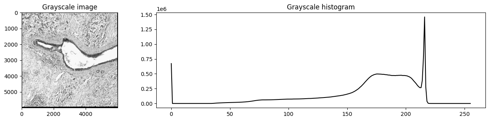
#### RGB
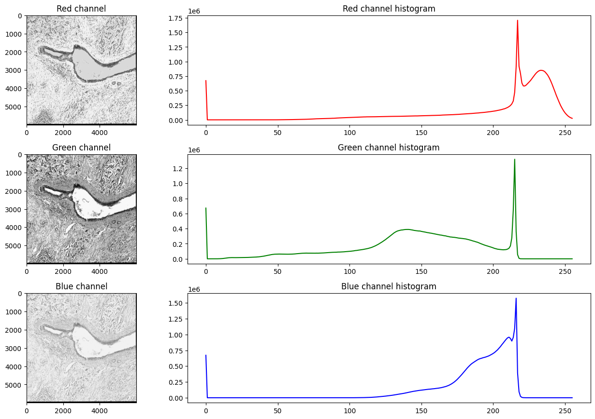
#### XYZ
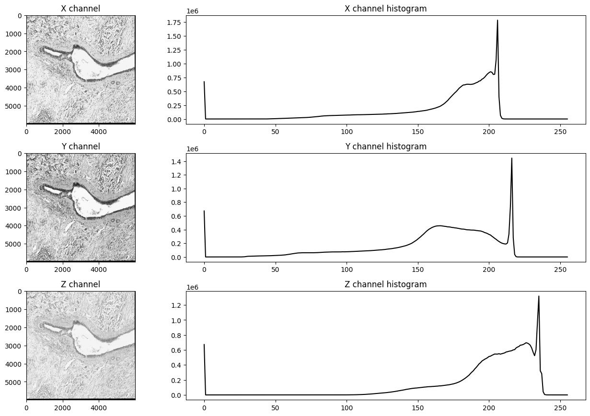
#### Lab
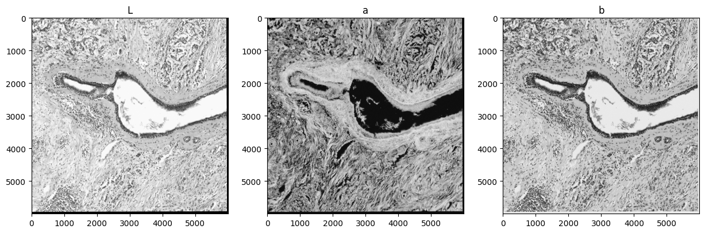
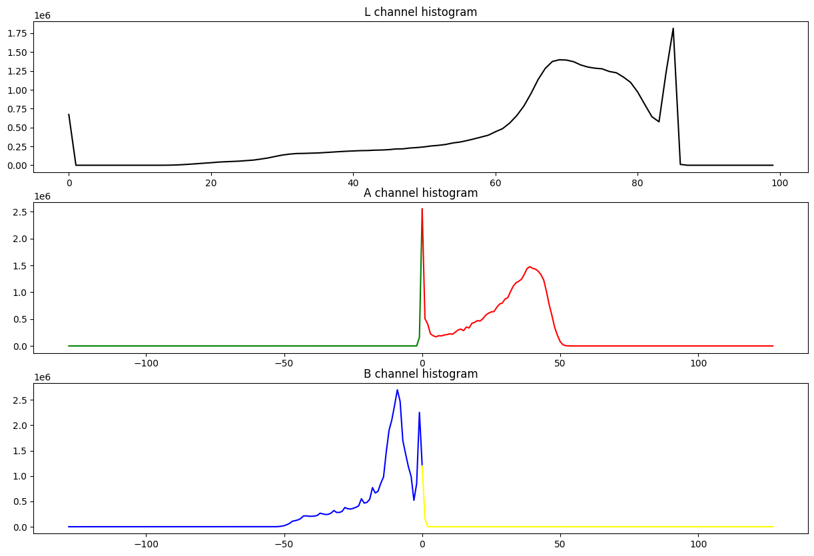
#### YCrCb
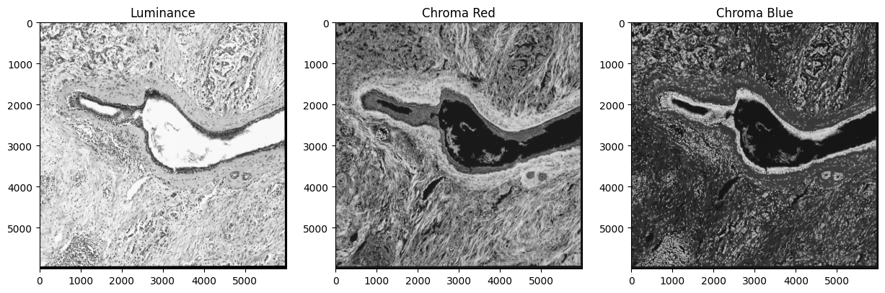
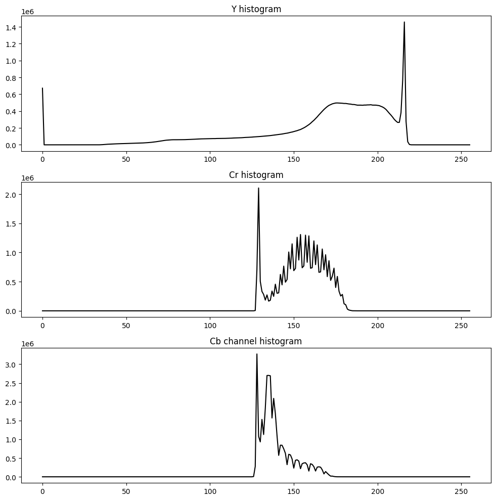

Všetky ostatné výsledky farebných systémov sa nachádzajú v súbore [image_correction.ipynb](image_correction.ipynb).


### Equalizácia histogramu

V rámci experimentovania s obrazom som vyskúšal aj metódu na equalizáciu histogramu.
Obraz som pred equalizáciou previedol do šedotónového obrazu a potom som použil funkciu `cv.equalizeHist()` na vyrovnanie histogramu.
Na dolných obrázkoch môžeme vidieť obraz a jeho histogram pred a po equalizácii.

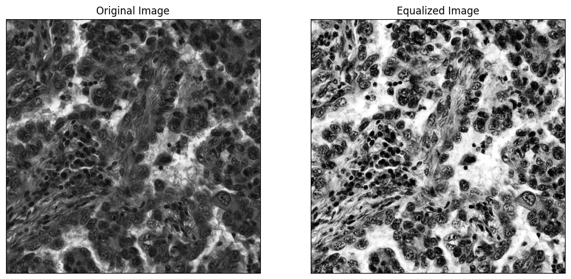
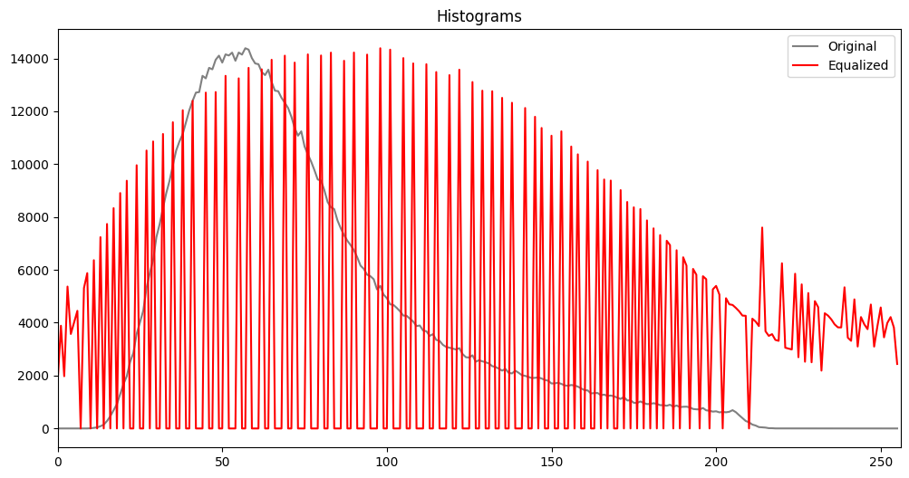


### Gamma korekcia

Vyskúšal som aj gamma korekciu obrazu, ktorú som implementoval pomocou funkcie `cv.pow()`.

```python
# Set gamma value
gamma = 1.5

# Apply gamma correction
corrected_img = cv.pow(img / float(np.max(img)), gamma)
```

Na obrázku nižšie je niekoľko ukážok gamma korekcie s rôznymi hodnotami gammy.

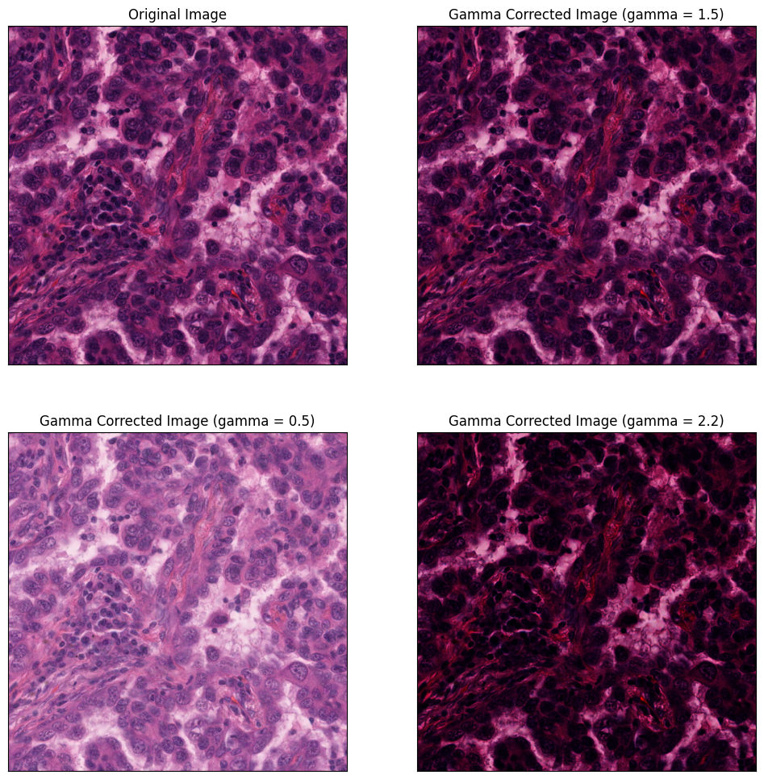


## 2. Experimenty s úpravou obrazu (image enhancement)

### Segmentácia s využitím informácií o farbách

Pri segmentácií som opäť začal s načítaním obrazu a jeho konverziou do farebného priestoru **Lab**, s hodnotami pixelov z rozsahu [0-1].
Ďalej som si z obrazu vybral malý región, ktorý obsahoval farbu buniek, ktoré som chcel vysegmentovať a vypočítal som priemernú farbu tohto regiónu

```python
# Load the image
img = cv.imread(file)
float32_img = img.astype(np.float32) / 255.0

# Convert to Lab color space
lab_img = cv.cvtColor(float32_img, cv.COLOR_BGR2LAB)

# Define the region of interest and its average 'Lab' color
roi = lab_img[2365:2398, 1622:1646]
avg_color = np.mean(roi, axis=(0, 1))

# Convert region of interest to RGB for visualization
roi_rgb = cv.cvtColor(roi, cv.COLOR_LAB2BGR)[:, :, ::-1]
avg_color_rgb = np.mean(roi_rgb, axis=(0, 1))
```

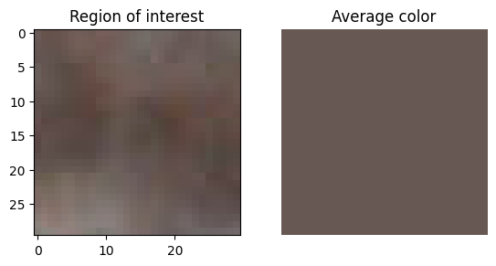

Potom som išiel vypočítať *delta lab* hodnotu pre každý pixel z obrázku.
Túto hodnotu som vypočítal ako euklidovskú vzdialenosť medzi *Lab* hodnotou farby daného pixelu a *Lab* hodnotou priemernej farby regiónu.
Následne som vytvoril masku, ktorá obsahovala iba pixely, ktoré boli dostatočne blízko priemernej farbe regiónu.
Masku som vytvoril cez threshold, pri ktorej som však nevedel pouźiť *OTSU* algoritmus, pretože výsledok nebol dostatočne dobrý.
Preto som nakoniec nastavil vlastnú hodnotu pre threshold.
Na nasledujúcom obrázku môžeme vidieť rozdiel medzi *OTSU* algoritmom a manuálnym nastavením thresholdu na hodnotu 15 pre obrázok *[HMRegistred.png](images/HMRegistred.png)*.

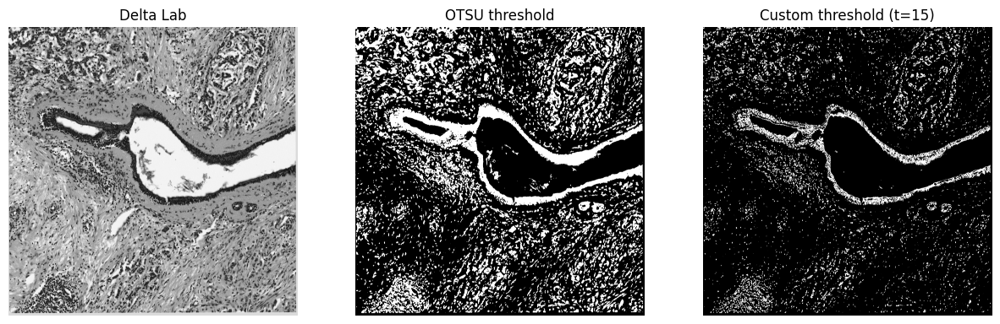

```python
# Calculate the delta Lab as euclidean distance for each pixel in the image
delta_lab = np.sqrt(np.sum(np.square(lab_img - avg_color), axis=2))

# Threshold the distance map
threshold = 20.0
mask = (delta_lab <= threshold).astype(np.uint8)

# Apply the mask to the original image
result = cv.bitwise_and(img, img, mask=mask)
```

Jednotlivé fázy procesu segmentácie obrazu *[P63Registred.png](images/P63Registred.png)* s využitím informácie o farbách som zobrazil na obrázkoch nižšie.

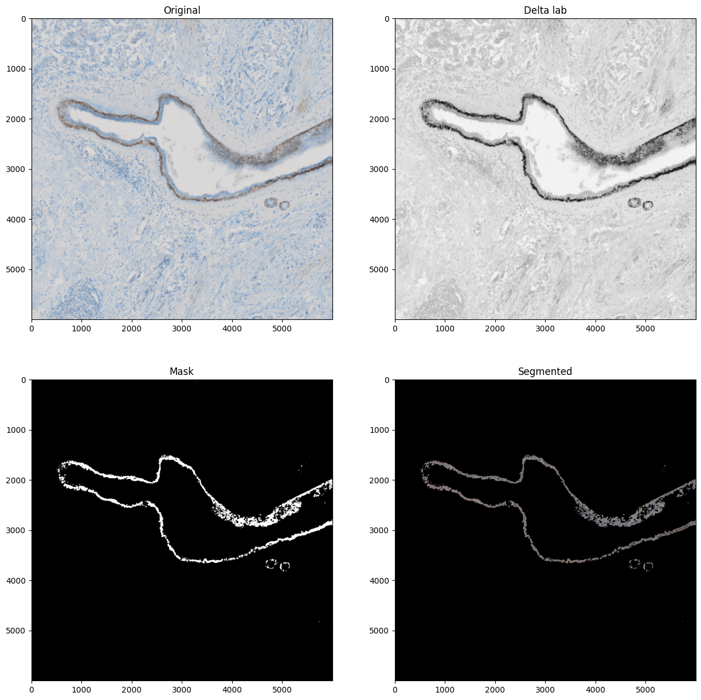

Proces segmentácie som aplikoval aj na druhý obrázok, ktorý obsahoval bunky iných farieb.
Pri výbere malého vzorového regiónu z obrazu som skúšal vyberať aj také regióny, ktoré mali iné rozmery a nachádzali sa v rozličných častiach obrazu.
Týmto procesom som získal takéto výsledky:

#### Väčšia fialová bunka s viditeľnými pozadím
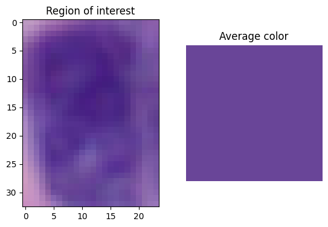
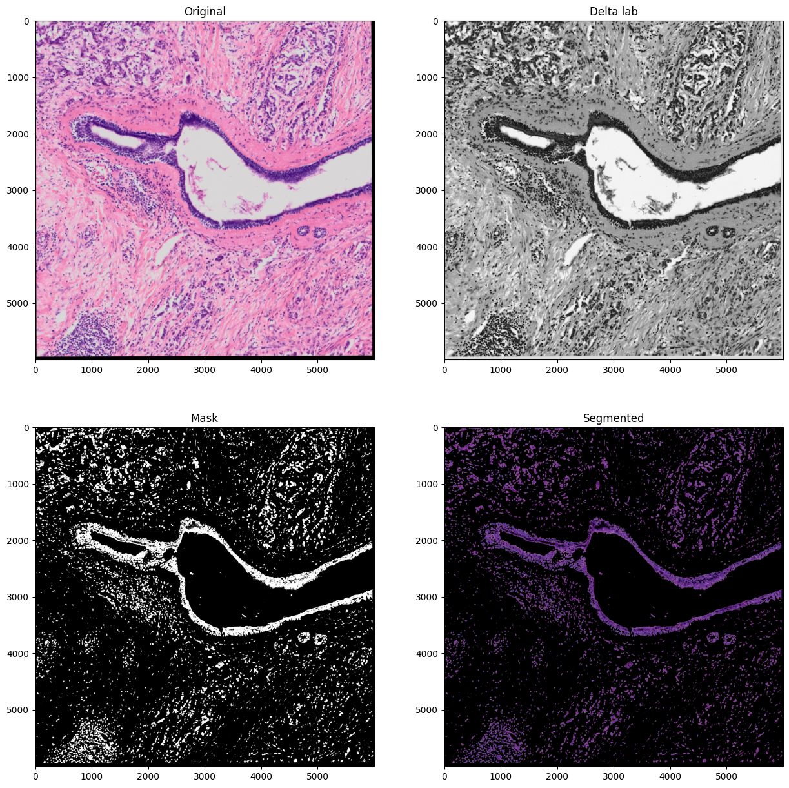

#### Malá fialová bunka bez viditeľného pozadia
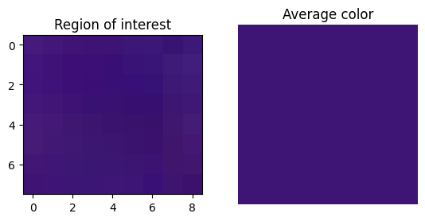
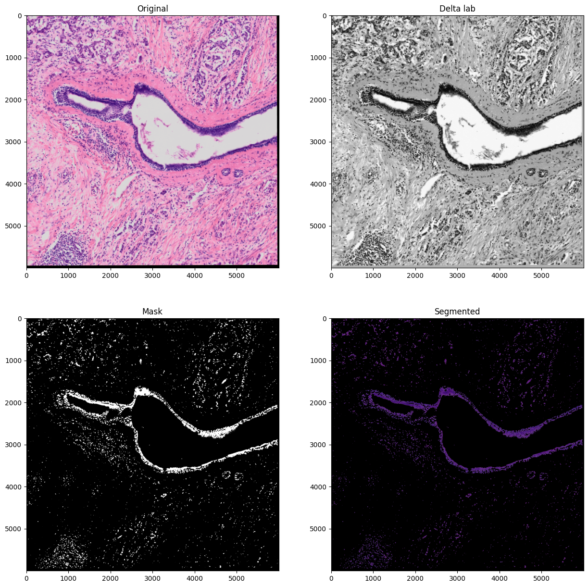


### Lokalizácia časti obrazu s použitím detektorov a deskriptorov

Pri lokalizácií som si najprv načítal 2 obrázky, jeden veľký a druhý malý, ktorý som chcel lokalizovať vo veľkom obraze.
Tieto obrázky som potom previedol do šedotónového obrazu.

```python
# Load the two images
lookup_img = cv.imread('images/Matching/lookup.tif')
patch_img = cv.imread('images/Matching/patch1.tif')

# Convert to grayscale
gray1 = cv.cvtColor(lookup_img, cv.COLOR_BGR2GRAY)
gray2 = cv.cvtColor(patch_img, cv.COLOR_BGR2GRAY)
```

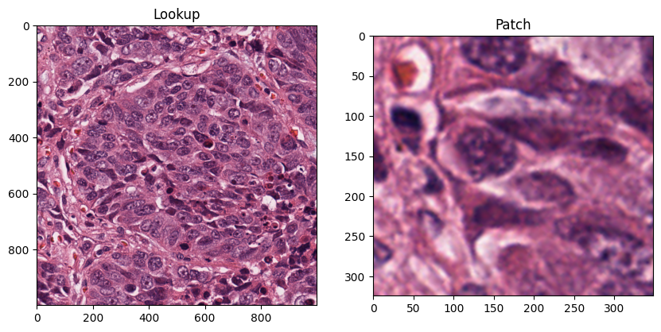

### TODO: doplniť popis detektorov a deskriptorov

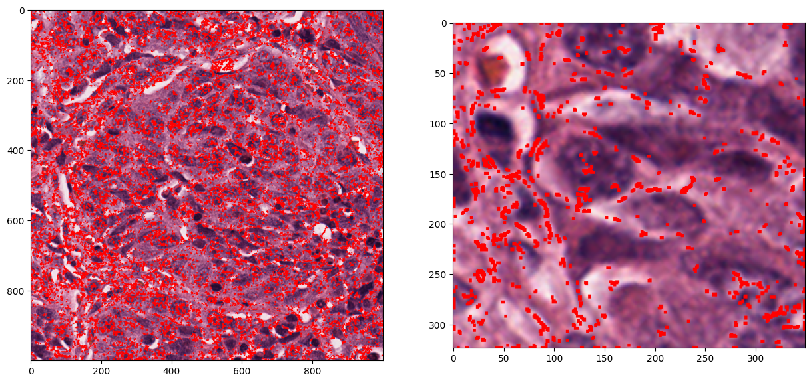

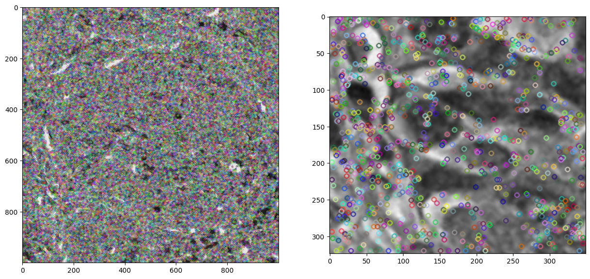

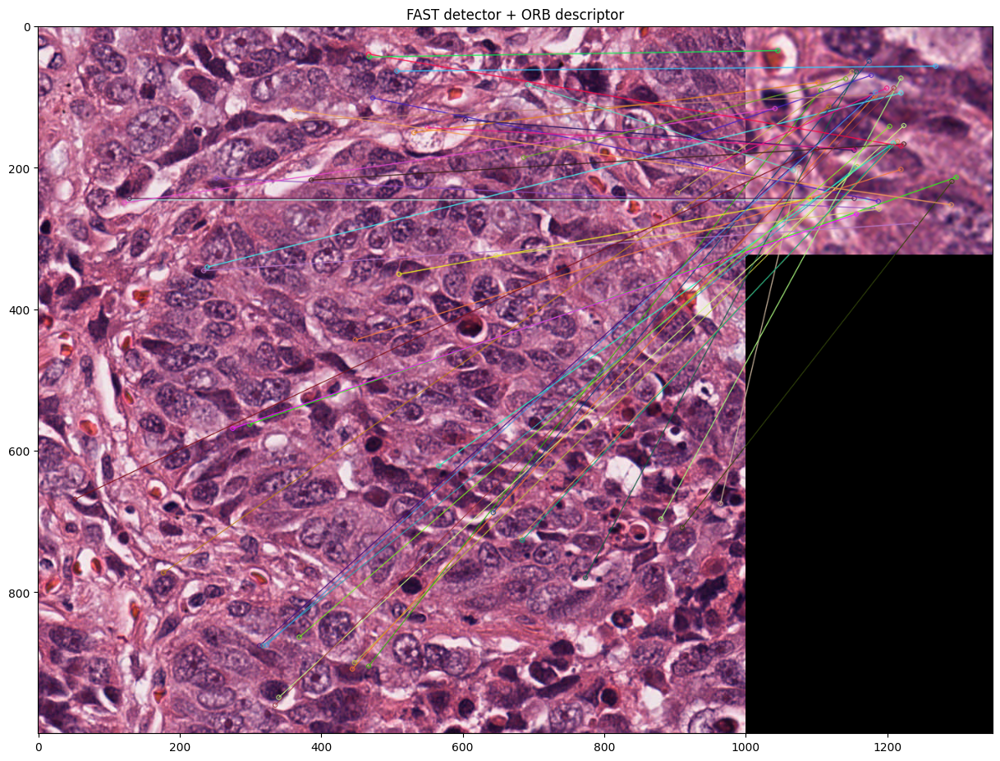

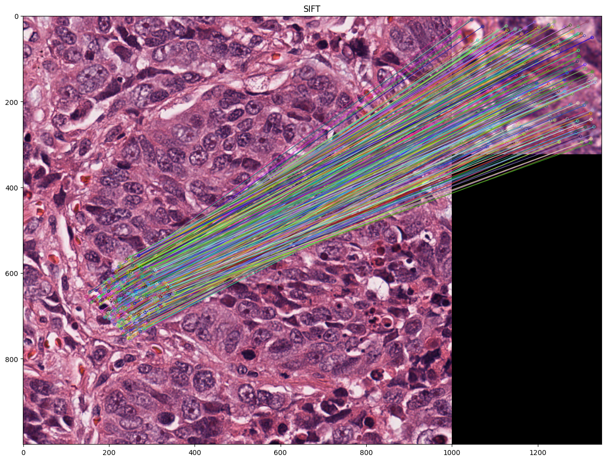

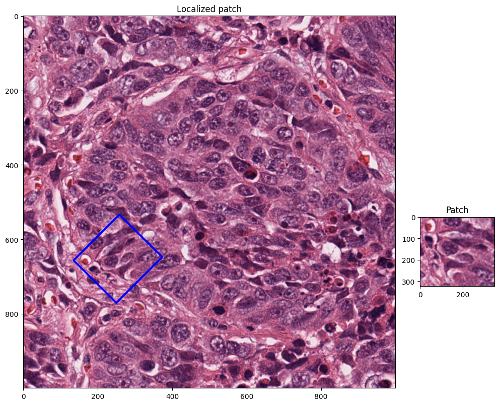

