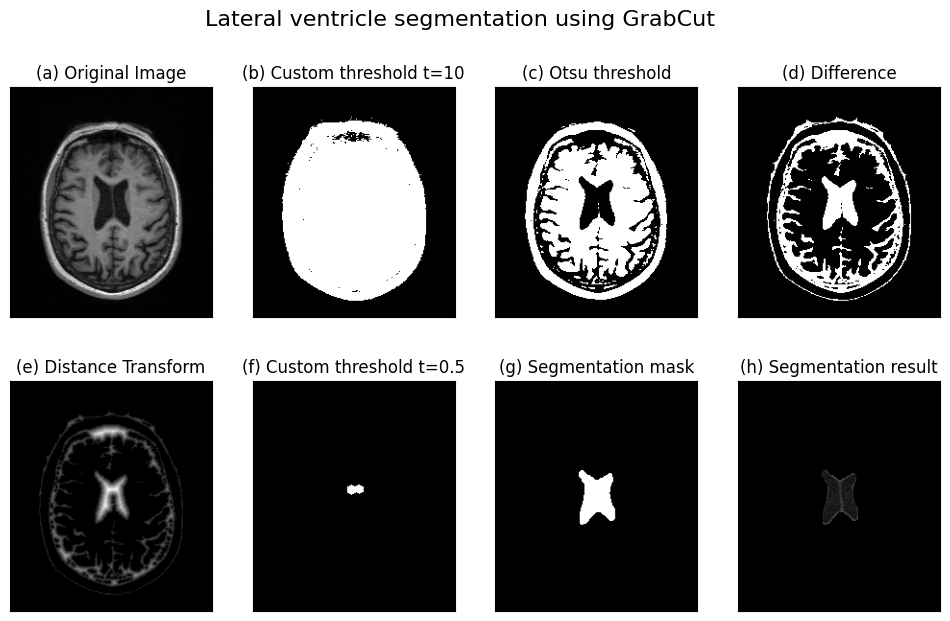
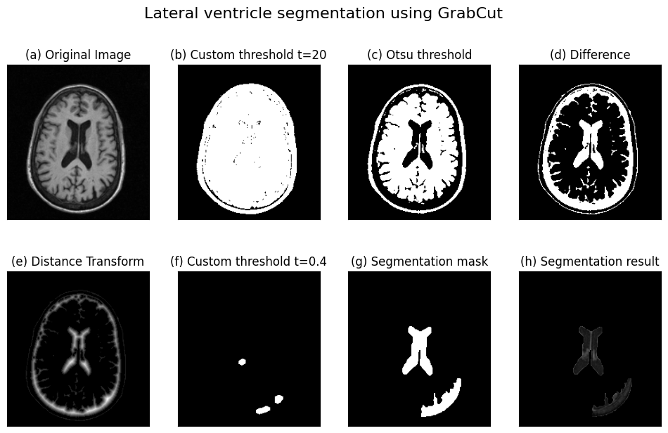
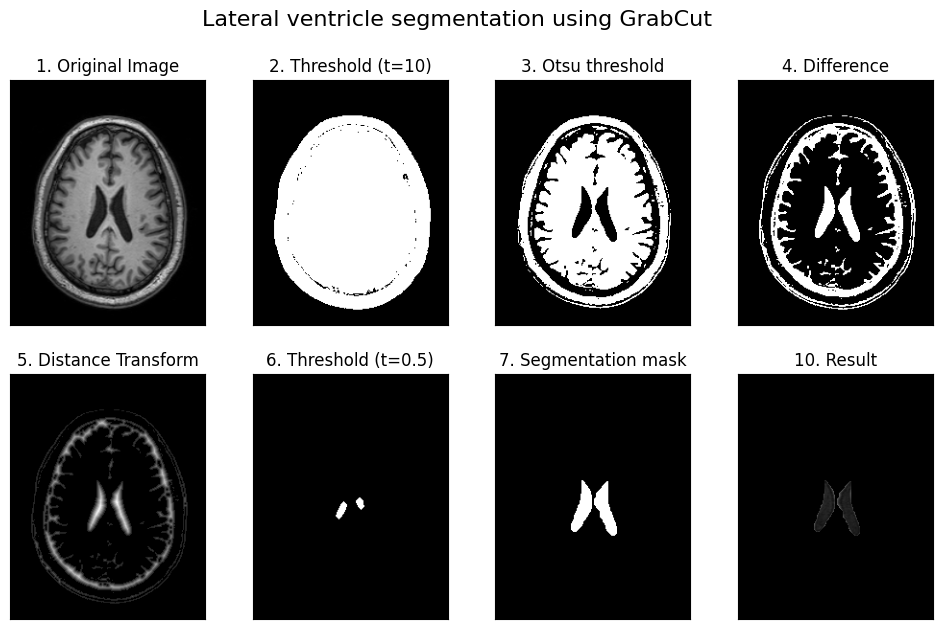
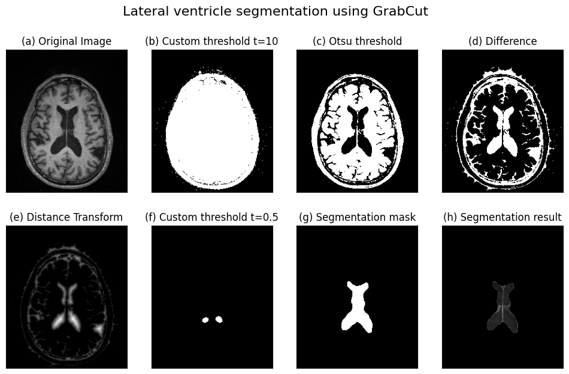
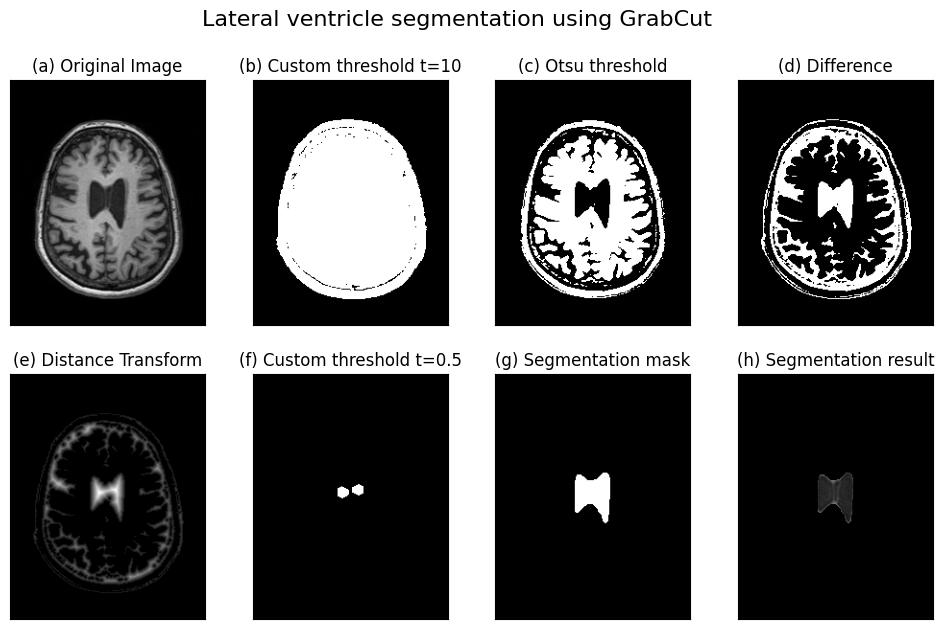

# Assignment 3

**Meno:** Ákos Kappel

**Predmet:** Počítačová videnie

**Cvičenie:** Pondelok 11:00

**Cvičiaci:** Ing. Marek Jakab, PhD.

**Použité knižnice:** OpenCV, Matplotlib, Numpy


## 1 Motion tracking

Prvú časť tohto zadania som začal s metódami na sledovanie pohybu objektov.
Vyskúšal som dve metódy, ktoré sú implementované v OpenCV: *sparse* a *dense optical flow*.

### 1.1 Sparse optical flow

Pri tejto metóde som začal s načítaním snímok z videa.
Po načítaní snímky sa po každých pár snímok zavolá funkcia `cv2.goodFeaturesToTrack()`.
Táto funkcia vráti zoznam bodov, ktoré sa považujú za vhodné na sledovanie pohybu objektov.
Interval vyberania bodov je nastaviteľný pomocou parametra `detecting_interval`.
Aby som predišiel nadmernému počtu bodov, ktoré sa majú sledovať, tak som vytvoril premennú `max_tracked_points`, ktorá určuje maximálny počet bodov, ktoré sa dajú naraz sledovať v jednej snímke.
Tieto body sa potom sledujú pomocou funkcie `cv2.calcOpticalFlowPyrLK()`.
Pre každý sledovaný bod si uchovávam jeho zoznam predchádzajúcich pozícií v premennej `trajectories`, aby som vedel vykresliť ich trajektoriu.
Aby som zabránil tomu, že niektoré body skočili na veľmi vzdialené miesta medzi snímkami, tak som vytvoril premennú `max_displacement_error`, ktorá určuje maximálnu vzdialenosť, ktorú môže bod prejsť medzi dvoma snímkami.
Kód pre celý tento postup sa nachádza v súbore [motion_tracking.ipynb](motion_tracking.ipynb) vo funkcií `sparse_optical_flow_v2()`, ale zjednodušená verzia kódu je takáto:

```python
cap = cv.VideoCapture(file)
trajectories = []

while cap.isOpened():
    # Read a frame from the video
    ...

    # Detect new points to track if necessary
    if frame_idx % detecting_interval == 0:
        pts = cv.goodFeaturesToTrack(curr_gray, mask=mask, **feature_params)
        for p in np.float32(pts).reshape(-1, 2):
            trajectories.append([p])

    # Extract the latest point from each trajectory
    pts0 = np.float32([trajectory[-1] for trajectory in trajectories]).reshape(-1, 1, 2)
    # Estimate the new positions of the tracked points in the current frame
    pts1, st, err = cv.calcOpticalFlowPyrLK(prev_gray, curr_gray, pts0, None, **flow_params)
    # Estimate the new positions of the tracked points in the previous frame (reverse optical flow)
    ptr0_rev, _, _ = cv.calcOpticalFlowPyrLK(curr_gray, prev_gray, pts1, None, **flow_params)
    # Calculate the displacement error between the original points and the reverse optical flow points
    displacement_error = abs(pts0 - ptr0_rev).reshape(-1, 2).max(-1)

    new_trajectories = []
    for i, (point, trajectory) in enumerate(zip(pts1.reshape(-1, 2), trajectories)):
        # Skip the point if the displacement error is too high
        if displacement_error[i] > max_displacement_error:
            continue

        # Add the new point to the trajectory
        trajectory.append(point)
        # Remove the oldest point if the trajectory is too long
        if trajectory_length is not None and len(trajectory) > trajectory_length:
            del trajectory[0]

        # Keep only updated trajectories
        new_trajectories.append(trajectory)

        # Draw the newest detected points on the image
        color = colors[i % num_colors].tolist()
        cv.circle(frame, point.astype(np.int32), 5, color, -1)
        # Draw the trajectory on the image
        cv.polylines(frame, [np.int32(trajectory)], False, color, 2)
    trajectories = new_trajectories

    # Display the resulting frame
    ...

cap.release()
cv.destroyAllWindows()
```

Výsledky z tejto metódy sú nasledovné:

https://user-images.githubusercontent.com/56064033/229316910-2a8e27e6-8a6b-4a30-be19-c0cc7d7c1eb2.mp4

https://user-images.githubusercontent.com/56064033/229316968-6f040cda-bc37-417b-a733-36e9936250d0.mp4

https://user-images.githubusercontent.com/56064033/229316841-afa858f0-94f5-41c2-b6f2-fd4075c6e61d.mp4

Na videách môžme vidieť, že sa celkom dobre podarilo sledovať pohyby objektov, ale mnoho sledovaých bodov sa vyskytuje na objektoch v pozadí, ktoré sa nehýbu.
Práve preto som skúsil pridať pri výbere sledovaných bodov aj masku, ktorá určuje, ktoré časti snímky sa majú sledovať.
Táto maska je vytvorená pomocou metódy na určenie pozadia (*Mixture of Gaussians*), ktorú používam aj v ďalšej časti tohto zadania.
Kód pre tento modifikovaný spôsob sledovania pohybu sa nachádza vo funkcií `sparse_optical_flow_v3()`.
Na nasledujúcich troch videách je ukážka výsledkov s pridanou maskou na výber sledovaných bodov:

https://user-images.githubusercontent.com/56064033/229512109-f0ce759e-d0ab-4cdd-b1f5-529365f5f65e.mp4

https://user-images.githubusercontent.com/56064033/229512255-d9f53257-f8a3-45e9-9c74-9b2390179566.mp4

https://user-images.githubusercontent.com/56064033/229512298-0ad1026f-af0b-4ba2-8c60-811105faa6fb.mp4

Na týchto videách je jasne vidieť, že sa po pridaní masky na výber sledovaných bodov výrazne zlepšila kvalita sledovania pohybu objektov.
Zároveň zmizli aj sledované body, ktoré sa nachádzali na pozadí a nehýbali sa.

### 1.2 Dense optical flow

Druhú metódu na sledovanie pohybu som opäť začal s načítaním jednotlivých snímok z videa.
Na každú snímku som aplikoval funkciu `cv2.calcOpticalFlowFarneback()`, ktorá vráti maticu s vektormi pohybu.
Z tejto matice som určil smer a rýchlosť pohybu pre každý bod snímky.
Aby som odstránil nežiadaný šum z pohybu, tak som odfiltroval všetky vektory, ktoré sú menšie ako hodnota v premennej `min_magnitude`.
Takto som získal masku, ktorá určuje, ktoré časti snímky sa pohli.
Pre ďalšie zlepšenie kvality sledovania pohybu som na masku aplikoval morfologické operácie *opening* a *closing*.
Výsledné vektory pohybu sa nachádzajú na pravej časti každej snímky.

Pre detekovanie ohraničujúcich boxov som najprv zistil kontúry na maske.
Potom som pre každú kontúru zistil súradnice najmenšieho obdĺžnika, ktorý ju obklopuje.
Získané boxy som ďalej prefiltroval podľa ich minimálneho obsahu.
Následne som aplikoval funkciu `non_max_suppression()`, ktorá zistí, ktoré boxy sa prekryvajú a z nich vyberie ten s najväčším obsahom.
Takto som získal výsledné boxy, ktoré sa vykreslia okolo pohybujúcich sa objektov.

Celý kód tejto metódy sa nachádza v súbore [motion_tracking.ipynb](motion_tracking.ipynb) vo funkcií `dense_optical_flow()`.
Najdôležitejšia časť tejto funkcie vyzerá takto:

```python
# Load the video
cap = cv.VideoCapture(file)

# Read, resize and convert the first frame to grayscale
_, frame = cap.read()
frame = cv.resize(frame, (0, 0), fx=scale, fy=scale)
prev_gray = cv.cvtColor(frame, cv.COLOR_BGR2GRAY)

hsv = np.zeros_like(frame)
hsv[..., 1] = 255

while cap.isOpened():
    # Read the next frame
    ...

    # Resize the frame (for faster processing)
    frame = cv.resize(frame, (0, 0), fx=scale, fy=scale)
    # Convert the frame to grayscale
    curr_gray = cv.cvtColor(frame, cv.COLOR_BGR2GRAY)

    # Calculate the dense optical flow using Farneback's method
    flow = cv.calcOpticalFlowFarneback(prev_gray, curr_gray, None, 0.5, 3, 15, 3, 5, 1.2, 0)

    # Calculate the magnitude and angle of the 2D vectors
    magnitude, angle = cv.cartToPolar(flow[..., 0], flow[..., 1], angleInDegrees=True)
    # Set image hue according to the optical flow direction
    hsv[..., 0] = angle / 2

    # Clip max value of the magnitude (because of possible infinity values)
    magnitude[magnitude > 10] = 10
    # Create a mask based on the magnitude
    mask = cv.inRange(magnitude, min_magnitude, 10)
    # Modify the mask to remove small objects
    if kernel is not None:
        mask = cv.morphologyEx(mask, cv.MORPH_OPEN, kernel, iterations=morph_iter)
        mask = cv.morphologyEx(mask, cv.MORPH_CLOSE, kernel, iterations=morph_iter)
    # Set image value according to the mask
    hsv[..., 2] = mask

    # Find the contours of the moving objects
    contours, _ = cv.findContours(mask, cv.RETR_EXTERNAL, cv.CHAIN_APPROX_SIMPLE)
    # Compute the bounding boxes of the contours
    rects = []
    for contour in contours:
        area = cv.contourArea(contour)
        if area > min_area:
            x, y, w, h = cv.boundingRect(contour)
            rects.append((x, y, x + w, y + h))
    rects = np.array(rects)
    # Remove overlapping bounding boxes
    rects = non_max_suppression(rects, probs=None, overlapThresh=0.2)

    # Draw the bounding boxes
    for x1, y1, x2, y2 in rects:
        cv.rectangle(frame, (x1, y1), (x2, y2), (0, 255, 0), 2)

    # Draw the optical flow
    ...

# Release the video capture and video write objects
cap.release()
cv.destroyAllWindows()
```

Získané výsledky sú nasledovné:

https://user-images.githubusercontent.com/56064033/229513257-589d4aee-d02c-4cde-b22f-f73458071323.mp4

https://user-images.githubusercontent.com/56064033/229513295-ed031ab9-a0b2-4235-825d-e54d4b6c37f1.mp4

https://user-images.githubusercontent.com/56064033/229513331-62e7f449-b320-427a-ab3b-f4b175c8934f.mp4


## 2 Segmentation

### 2.1 Background subtraction

Pri segmentácii pozadia som začal s metódou *Accumulated Weighted Image* a potom som vyskúšal aj metódu *Mixtures of Gaussians*.
Kód pre obidve tieto metódy sa nachádza v súbore [background_subtraction.ipynb](background_subtraction.ipynb)

#### 2.1.1 Accumulated weighted image

Táto metóda funguje tak, že si v premennej `bg_model` uchovávam model pozadia, ktorý sa počíta ako vážený priemer predchádzajúcich snímok.
Pri čítaní jednotlivých snímok z videa si pomocou funkcie `cv.accumulateWeighted()` aktualizujem tento model.
Potom si pomocou tohto modelu vytvorím masku pre objekty v popredí.
Na masku aplikujem morfologické operácie (*opening* a *closing*), aby som z nej odstránil šum a iné nežiadané artefakty.
Na záver si pomocou funkcie `cv.bitwise_and()` vyextrahujem objekty z popredia.
Hlavná časť kódu, ktorá slúži pre výpočet modelu pozadia je nasledovná:

```python
# Read the first frame
_, frame = cap.read()
# Initialize the background model
bg_model = np.float32(frame)

while cap.isOpened():
    # Read the next frame of the video
    ...

    # Update the background model using an accumulated weighted image
    cv.accumulateWeighted(frame, bg_model, alpha)

    # Subtract the background
    background = cv.convertScaleAbs(bg_model)
    diff = cv.absdiff(frame, background)

    # Apply a threshold to the difference image
    _, thresh = cv.threshold(diff, threshold, 255, cv.THRESH_BINARY)
    # Apply a morphological operations to the thresholded image
    thresh = cv.morphologyEx(thresh, cv.MORPH_CLOSE, kernel, iterations=2)
    thresh = cv.morphologyEx(thresh, cv.MORPH_OPEN, kernel, iterations=2)

    # Extract the foreground
    foreground = cv.bitwise_and(frame, frame, mask=thresh)
    
    # Display the results
    ...

# Release the VideoCapture and close all windows
cap.release()
cv.destroyAllWindows()
```

Výsledky z metódy *Accumulated Weighted Image* sú zobrazené na nasledujúcich videách.
Každé video má 4 oblasti.
Ľavá horná časť zobrazuje pôvodné video, ľavá dolná časť zobrazuje vypočítané pozadie.
Na pravej hornej časti je maska pre objekty v popradí a na pravej dolnej časti sú znázornené objekty, ktoré som získal aplikovaní masky na pôvodné video.

https://user-images.githubusercontent.com/56064033/229830230-3cd34ee7-2f80-4296-b766-bdbfab45ca54.mp4

https://user-images.githubusercontent.com/56064033/229830439-7184f68a-d723-4cae-b6f8-07b660091b6a.mp4

https://user-images.githubusercontent.com/56064033/229830574-a4f9eb17-a027-41a8-bffe-51929f9369eb.mp4

#### 2.1.2 Mixture of Gaussians

Pri tejto metóde som použil triedu `cv.createBackgroundSubtractorMOG2()`, ktorá vytvorí objekt, ktorý sa postará o výpočet modelu pozadia.
Z tohto objektu si potom získam masku pre objekty v popredí.
Túto masku opäť opravím morfologickými operáciami a na záver si pomocou funkcie `cv.bitwise_and()` vyextrahujem objekty z popredia.

```python
fgbg = cv.createBackgroundSubtractorMOG2()

# Read the frames from the camera
cap = cv.VideoCapture(file)
while cap.isOpened():
    # Read next frame
    ...

    # Apply mask for background subtraction
    fg_mask = fgbg.apply(img)

    # Apply morphological operation
    if morph_iter > 0:
        fg_mask = cv.morphologyEx(fg_mask, cv.MORPH_CLOSE, kernel, iterations=morph_iter)
        fg_mask = cv.morphologyEx(fg_mask, cv.MORPH_OPEN, kernel, iterations=morph_iter)

    # Extract the foreground and background
    foreground = cv.bitwise_and(img, img, mask=fg_mask)
    background = fgbg.getBackgroundImage()

    # Display the resulting frames
    ...

# Release the VideoCapture and close all windows
cap.release()
cv.destroyAllWindows()
```

Výsledky z metódy *Mixtures of Gaussians* sú takéto:

https://user-images.githubusercontent.com/56064033/229830282-c00b46e1-3fa7-4f9b-956c-202870917349.mp4

https://user-images.githubusercontent.com/56064033/229830533-d56fd738-b54f-4202-91cc-5bc31cc11f0c.mp4

https://user-images.githubusercontent.com/56064033/229830610-7b3d5b42-8f1c-4b38-97e0-d7269384d456.mp4


### 2.2 GrabCut

TODO








### 2.3 VOC12

