# Assignment 4

**Meno:** Ákos Kappel

**Predmet:** Počítačová videnie

**Cvičenie:** Pondelok 11:00

**Cvičiaci:** Ing. Marek Jakab, PhD.

**Použité knižnice:** Tensorflow, Keras, OpenCV, Matplotlib, Numpy, Albumentations, segmentation_models

**Obsah súborov v adresári:**

* [main.ipynb](main.ipynb) - Jupyter notebook s načítaním dát a trénovaním modelu
* [EDA.ipynb](EDA.ipynb) - Analýza dát (Exploratory Data Analysis)
* [HyperParamSearch.ipynb](HyperParamSearch.ipynb) - Jupyter notebook s hľadaním optimálnych hyperparametrov
* [networks.py](networks.py) - Implementácie viacerých druhov CNN sietí, vlastné loss funkcie a iné pomocné funkcie


## 1 Zadanie problému

Pre toto zadanie som si vybral segmentačnú úlohu, ktorej cieľom je segmentovať obrázky podmorských snímok do ôsmich tried.
Tieto triedy sú:

1. ryby (stavovce)
2. koralové útesy
3. vodné rastliny
4. vraky / ruiny
5. ľudský potápači
6. morské roboty (technika)
7. morské dno
8. iné (pozadie)

Dáta pochádzajú z datasetu s názvom [SUIM](https://irvlab.cs.umn.edu/resources/suim-dataset), ktorý obsahuje odborníkmi anotované obrázky.

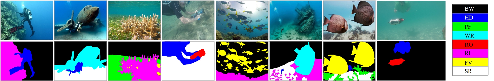


## 2 Analýza dát

Dataset bol pôvodne rozdelený na dve časti (*train_val* a *TEST*).
Prvú časť som si rozdelil na trénovaciu a validačnú množinu v pomere 90:10.
Výsledný dataset má teda nasledovné rozdelenie:

- train (1372 obrázkov)
- val (153 obrázkov)
- test (110 obrázkov)

Každý obrázok aj maska sú vo formáte RGB.
V rámci analýzi dát som zistil, že nie všetky obrázky majú rovnaké rozmery.
Väčšina obrázkov má 480x640 pixelov, ale existujú aj obrázky s inými rozmermi.

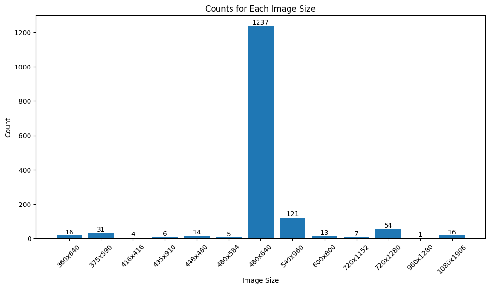

Tento problém som vyriešil zmenou rozmerov obrázkov na rovnaké hodnoty.
Ďalším problémom v datasete bolo to, že triedy nie sú rovnomerne zastúpené.

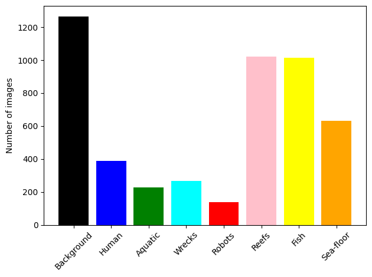

Ako môžeme vidieť na grafe, najviac sú v datasete zastúpené triedy pre pozadie, morské dno, ryby a koraly.
Naopak, najmenej sú zastúpené triedy pre ľudských potápačov, morské roboty, vodné rastliny a vraky.
Tento problém som vyriešil tak, že som použil stratovú funkciu **focal loss**, ktorá znižuje váhu tried, ktoré sú častejšie zastúpené v datasete.

Posledným problémom, ktorý som musel vyriešiť bol formát masky.
Masky boli pôvodne vo formáte RGB, ale pre trénovanie modelu som ich musel pretransformovať do **one-hot encoded** formátu.
Na prekonvertovanie som si vytvoril flastné funkcie:

```python
# Encode RGB mask to class indices in range [0, num_classes - 1]
def rgb_to_class_indices(mask):
    class_colors_tensor = tf.constant(CLASS_COLORS, dtype=tf.float32)
    # Calculate the similarity between the RGB mask and class colors
    similarity = tf.reduce_sum(tf.abs(tf.subtract(mask, class_colors_tensor[:, None, None, :])), axis=-1)
    # Find the index of the class color with the minimum similarity
    class_indices_mask = tf.argmin(similarity, axis=0)
    return class_indices_mask


# One-hot encode class indices (e.g. [1, 3, 0] -> [[0, 1, 0, 0], [0, 0, 0, 1], [1, 0, 0, 0]])
def class_indices_to_one_hot(mask):
    one_hot_mask = tf.one_hot(mask, NUM_CLASSES, dtype=tf.int32)
    one_hot_mask = tf.cast(one_hot_mask, tf.float32)
    return one_hot_mask


# Encode RGB mask to one-hot mask (e.g. [[0, 0, 1], [1, 0, 0]] -> [[0, 1, 0, 0], [1, 0, 0, 0]])
def rgb_to_one_hot(mask):
    indices_mask = rgb_to_class_indices(mask)
    one_hot_mask = class_indices_to_one_hot(indices_mask)
    return one_hot_mask
```

Pomocou týchto funkcií sa RGB masky dajú jednoducho prekonvertovať do one-hot encoding tvaru.
Ukážku pred a po konverzii môžeme vidieť na nasledujúcich dvoch obrázkoch.

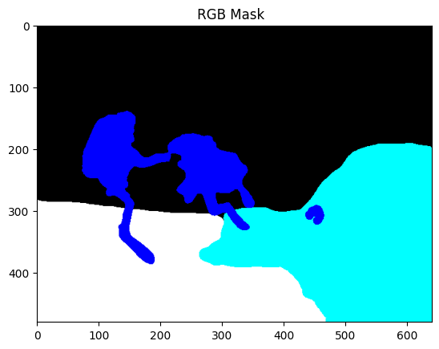
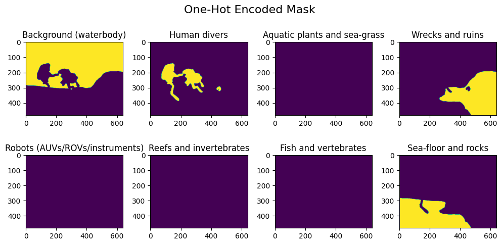


## 3 Preprocessing

Na načítanie datasetu som vytvoril funkciu `load_dataset`, ktorá vráti tri generátory pre trénovaciu, validačnú a testovaciu množinu.
Pri načítavaní dát som potreboval použiť generátory, pretoźe dáta sú príliš veľké na to, aby sa dali načítať naraz do pamäte.
Každý generátor vráti dvojicu `(image, mask)`, kde `image` je RGB obrázok a `mask` je one-hot encoded maska.
Predspracovanie dát sa vykonáva v rámci generátora.
Celý postup načítania a predspracovania dát je nasledovný:  

1. Načítanie názvov súborov pre obrázky a masky
```python
train_val_images = list_files(os.path.join(path, 'train_val/images'))
train_val_masks = list_files(os.path.join(path, 'train_val/masks'))
test_images = list_files(os.path.join(path, 'TEST/images'))
test_masks = list_files(os.path.join(path, 'TEST/masks'))
```

2. Rozdelenie `train_val` množiny na trénovaciu a validačnú množinu v pomere 90:10
```python
train_images, val_images, train_masks, val_masks = train_test_split(
    train_val_images, train_val_masks, test_size=val_split, random_state=seed
)
```

3. Vytvorenie troch generátorov
```python
train_dataset = tf.data.Dataset.from_tensor_slices((train_images, train_masks))
val_dataset = tf.data.Dataset.from_tensor_slices((val_images, val_masks))
test_dataset = tf.data.Dataset.from_tensor_slices((test_images, test_masks))
```

4. Zamiešanie trénovacej množiny
```python
# Shuffle train dataset
train_dataset = train_dataset.shuffle(len(train_images))
```

5. Predspracovanie dát + augmentácia
```python
preprocess_train = lambda x, y: preprocessing(x, y, augment=True)
preprocess_test = lambda x, y: preprocessing(x, y, augment=False)

train_dataset = train_dataset.map(preprocess_train, num_parallel_calls=tf.data.AUTOTUNE)
val_dataset = val_dataset.map(preprocess_test, num_parallel_calls=tf.data.AUTOTUNE)
test_dataset = test_dataset.map(preprocess_test, num_parallel_calls=tf.data.AUTOTUNE)
```

Pre augmentáciu obrázkov som použil knižnicu `albumentations`, ktorá slúži na jednoduchú augmentáciu obrázkov.
Pri augmentácii som musel dbať na to, aby sa augmentácia vykonávala rovnako na obrázku aj na maske.
Napríklad pri vykonávaní rotácie obrazu bolo nevyhnutné, aby príslušná maska prešla rovnakým otočením.
V rámci augmentácie som použil nasledovné techniky:
- Horizontálne zrkadlenie
- Rotácia o náhodný uhol v rozsahu [-45, 45]
- Náhodná zmena jasu a kontrastu alebo náhodná zmena gama korekcie
- Náhodný blur (Gaussovský alebo Median)

```python
Augmentation = A.Compose([
    A.HorizontalFlip(p=0.5),
    A.Rotate(limit=45, p=0.75, interpolation=cv.INTER_NEAREST, border_mode=cv.BORDER_REFLECT_101),
    A.OneOf([
        A.RandomBrightnessContrast(brightness_limit=0.2, contrast_limit=0.2, p=0.5),
        A.RandomGamma(gamma_limit=(80, 120), p=0.5),
    ], p=0.75),
    A.OneOf([
        A.Blur(blur_limit=3, p=0.5),
        A.MedianBlur(blur_limit=3, p=0.5),
    ], p=0.75),
])
```

Pre padding som použil `cv2.BORDER_REFLECT_101`, ktorý odzrkadlí okraje obrázka a na interpoáciu som použil `cv2.INTER_NEAREST`, aby som zachoval celočíselné hodnoty pixelov masky.
Dvojice augmentovaných obrázkov a masiek vyzerajú nasledovne:

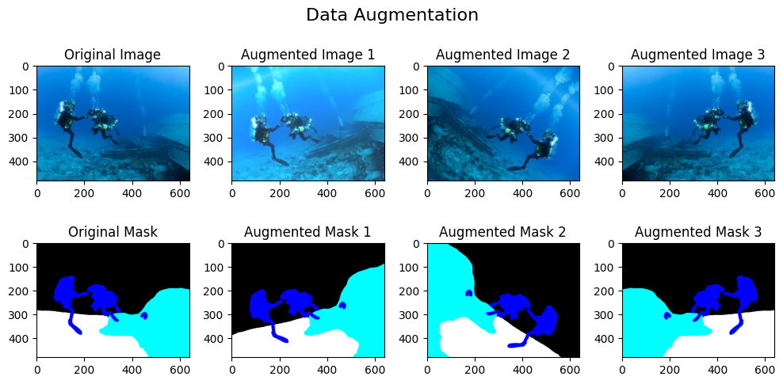


## 4 U-Net architektúry

Na segmentáciu obrázkov som vyskúšal viaceré modifikácie U-Net architektúry.
Začal som s pôvodnou U-Net architektúrou, pre ktorú som si musel vytvoriť encoder a decoder bloky.

```python
def encoder_block(input_tensor, n_filters: int, kernel_size: int = 3, **kwargs):
    x = conv_block(input_tensor, n_filters=n_filters, kernel_size=kernel_size, **kwargs)
    p = layers.MaxPooling2D((2, 2))(x)
    return x, p


def decoder_block(input_tensor, skip_tensors, n_filters: int, kernel_size: int = 3, **kwargs):
    u = layers.Conv2DTranspose(n_filters, (2, 2), strides=(2, 2), padding='same')(input_tensor)
    c = layers.concatenate([u, *skip_tensors])
    x = conv_block(c, n_filters=n_filters, kernel_size=kernel_size, **kwargs)
    return x
```

Z týchto blokov som potom vytvoril U-Net, ktorá sa skladá z encoderu a decoderu.
Keďže sa jedná o viactriednu segmentáciu, tak ako aktivačnú funkciu na výstupnej vrstve som použil **softmax**.
Počet konvolučných filtrov v encoderi sa na každej vrstve zdvojnásobuje, aby sa lepšie zachovala informácia o detailoch.
Veľkosť kernelu som zvolil *3x3*.

```python
filters = [num_filters * 2 ** i for i in range(5)]  # e.g. [32, 64, 128, 256, 512]
inputs = layers.Input(shape=input_shape)

# Encoder
conv1, pool1 = encoder_block(inputs, filters[0], kernel_size=3)
conv2, pool2 = encoder_block(pool1, filters[1], kernel_size=3)
conv3, pool3 = encoder_block(pool2, filters[2], kernel_size=3)
conv4, pool4 = encoder_block(pool3, filters[3], kernel_size=3)

# Bottleneck (bridge)
conv5 = conv_block(pool4, filters[4], kernel_size=3)

# Decoder
up1 = decoder_block(conv5, [conv4], filters[3], kernel_size=3)
up2 = decoder_block(up1, [conv3], filters[2], kernel_size=3)
up3 = decoder_block(up2, [conv2], filters[1], kernel_size=3)
up4 = decoder_block(up3, [conv1], filters[0], kernel_size=3)

outputs = conv_block(up4, num_classes, kernel_size=1, n_blocks=1, activation='softmax')
unet = keras.Model(inputs=[inputs], outputs=[outputs], name='U-Net')
```

Výsledná architektúra modelu vyzerá nasledovne:

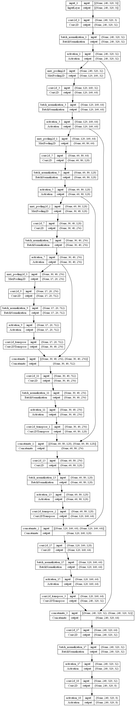

Okrem pôvodnej U-Net architektúry som vyskúšal aj modifikácie s názvami **U-Net++** a **U-Net 3+**, ktoré som našiel v článkoch [UNet++: A Nested U-Net Architecture for Medical Image Segmentation](https://arxiv.org/abs/1807.10165) a [U-Net 3+: A Full-Scale Connected UNet for Medical Image Segmentation](https://arxiv.org/abs/2004.08790).
U-Net++ je modifikácia U-Net architektúry, ktorá využíva tzv. *dense skip connections*.
U-Net 3+ je ďalšia modifikácia U-Net architektúry, ktorá využíva tzv. *full-scale skip connections*.
Všetky tri tieto architektúry sú zobrazené na nasledujúcom obrázku:

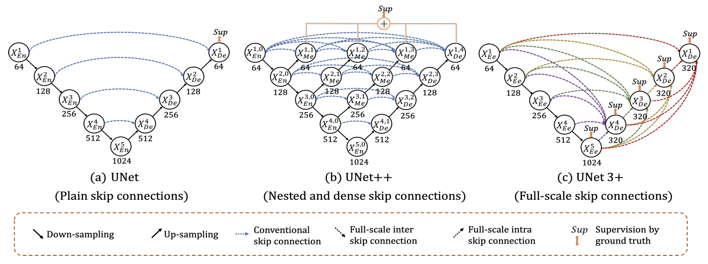


## 5 Trénovanie modelu

Na trénovanie modelov som používal *Kaggle*, kvôli prístupu k výkonnejším GPU, ktoré výrazne urýchlili dobu trénovania.
Pri trénovaní prvého modelu som použil 50 epoch, batch size 4 a learning rate 0.0003.
Po každej epoche som vyhodnotil model na validačnej množine a uložil som si model s najlepším skóre.
Ako metriky som použil **Categorical Accuracy**, **IoU** (Intersection over Union / Jaccard Index) a **Dice Coefficient**.
Tieto metriky som aj sám naimplementoval pomocou knižnice *Keras*:

```python
def jaccard_coef(y_true, y_pred, smooth: float = 1.0):
    y_true_f = K.flatten(y_true)
    y_pred_f = K.flatten(y_pred)
    intersection = K.sum(K.abs(y_true_f * y_pred_f))
    union = K.sum(y_true_f) + K.sum(y_pred_f) - intersection
    return K.mean((intersection + smooth) / (union + smooth))

def dice_coef(y_true, y_pred, smooth: float = 1.0):
    y_true_f = K.flatten(y_true)
    y_pred_f = K.flatten(y_pred)
    intersection = K.sum(y_true_f * y_pred_f)
    area_true = K.sum(y_true_f)
    area_pred = K.sum(y_pred_f)
    return K.mean((2. * intersection + smooth) / (area_true + area_pred + smooth))
```

Pre loss funkciu som použil kombináciu **Dice Loss** a **Categorical Focal loss**.
Dice Loss je definovaná ako `1 - Dice Coefficient`.
Túto hybridnú loss funkciu som prevzal z knižnice *segmentation_models*.
Pre **Focal Loss** som sa rozhodol, pretože je vhodný pre nevyvážené dáta, čo je aj môj prípad.
Počas tréningu som na niekoľkých dátach z validačnej množiny zobrazoval predikcie modelu.

#### Výsledky po prvej epoche:
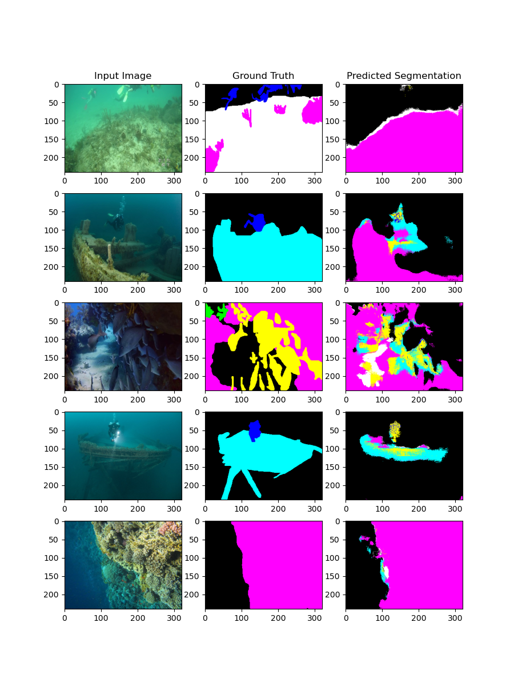

#### Výsledky po 50. epoche:
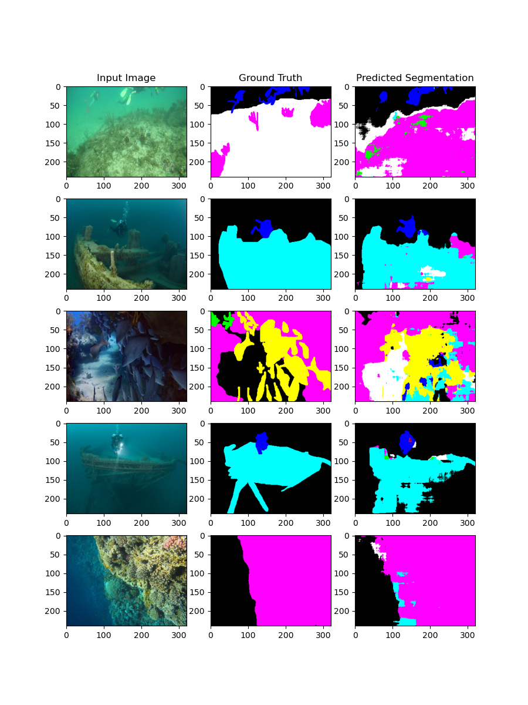


## 6 Hľadanie optimálnych hyperparametrov

Na hľadanie optimálnych hyperparametrov som použil službu [*Weights & Biases*](https://wandb.ai/site).
Táto služba umožňuje jednoduché sledovanie tréningu modelu a hľadanie optimálnych hyperparametrov.
Vśetky logy z tréningu som logoval do tejto služby a následne som vytvoril report, ktorý obsahuje výsledky zo všetkých trénovaní.
Tento report je dostupný [tu](https://api.wandb.ai/links/xkap-team/h26oc6e9).

Na hľadanie hyperparametrov som použil metódu *Grid Search*, avšak musel som obmedziť počet kombinácií hyperparametrov, pretože trénovanie jednej konfigurácie trvalo celkom dlho.
Preto som sa rozhodol, že budem hľadať optimálne hodnoty iba pre parametre `learning_rate`, `batch_size`, `dropout_rate` a `num_filters`.
Hyperparametre som hľadal iba pre prvotnú U-Net architektúru a použil som pri tom *WandB* konfiguráciu s nasledujúcimi hyperparametrami:

```python
sweep_config = {
    'method': 'grid',
    'metric': {
        'name': 'val_dice_coef',
        'goal': 'maximize',
    },
    'parameters': {
        'learning_rate': {
            'values': [1e-2, 1e-3]
        },
        'batch_size': {
            'values': [4, 8, 16]
        },
        'dropout_rate': {
            'values': [0.0, 0.25, 0.5]
        },
        'num_filters': {
            'values': [8, 16, 32, 64]
        },
    }
}
```

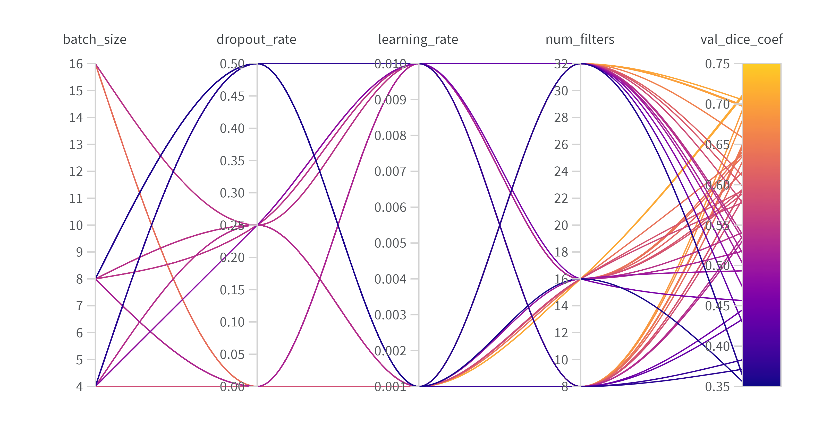

Z grafu vyplýva, že najlepšie výsledky dosahovali modely s nízkym `learning_rate` a s vysokým `batch_size` a `num_filters`.
`dropout_rate` mal skôr negatívny vplyv, keďže nedochádzalo k pretrénovaniu modelu.
Podľa zistených optimálnych hyperparametrov som natrénoval ešte jeden nový model s názvom *Wider U-Net*, ktorému som nastavil `learning_rate=0.001`, `batch_size=16`, `dropout_rate=0.0` a `num_filters=64`.


## 7 Vyhodnotenie modelov

Na vyhodnotenie modelov som použil testovaciu množinu, ktorá obsahuje 110 obrázkov.
Výsledky som porovnal medzi štyrmi modelmi:

- U-Net
- Wider U-Net
- U-Net++
- U-Net3+

Na grafe je vidieť, že dosiahnuté výsledky sú veľmi podobné.
O trochu lepšie výsledky dosiahol model s väčším počtom filtrov, avšak rozdiel je minimálny.
Rozdiel medzi modelmi je najviditeľnejší na metrike *Dice Coefficient*, kde model *Wider U-Net* dosiahol najlepšie hodnoty.

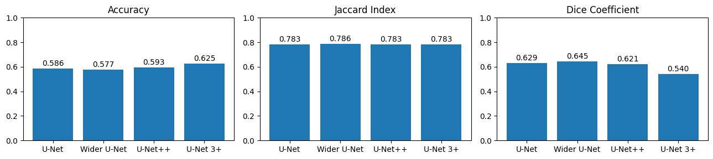

#### Ukážka niekoľkých najlepších výsledkov:
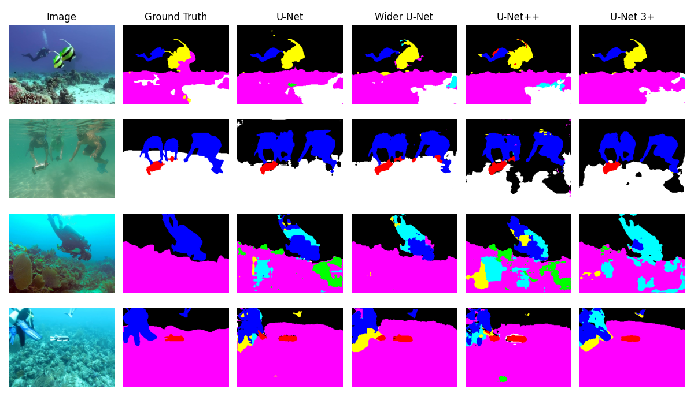
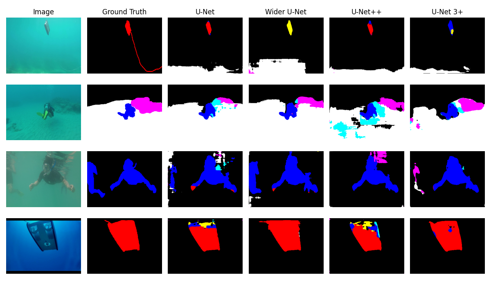
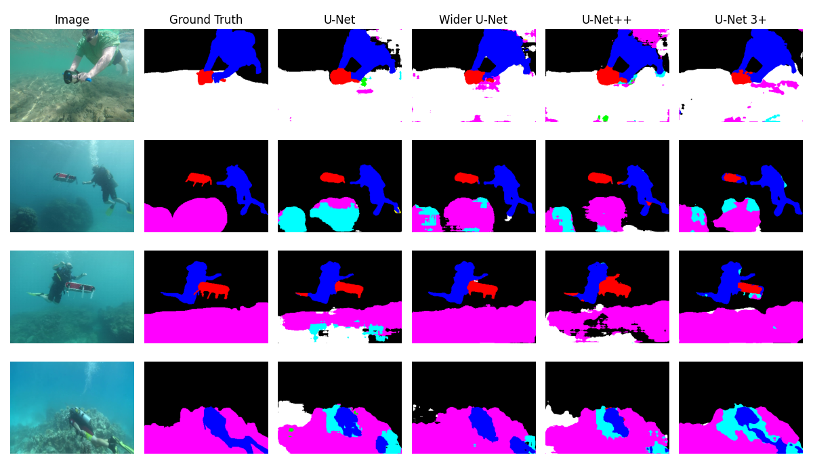
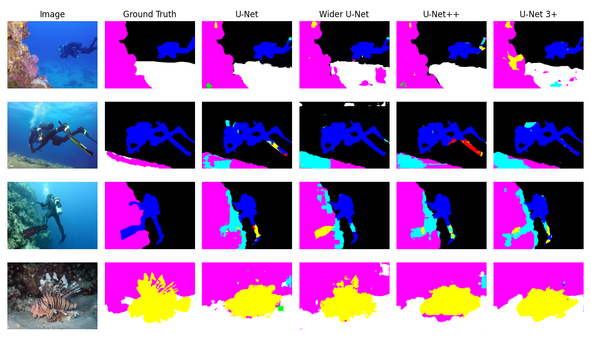
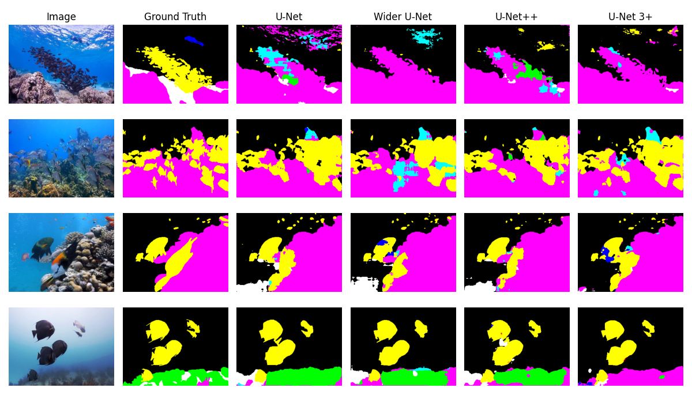
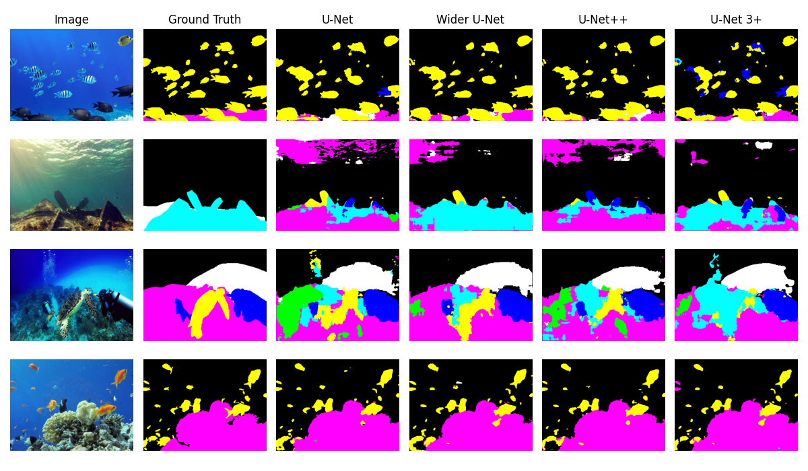

#### Ukážka niekoľkých najhorších výsledkov:
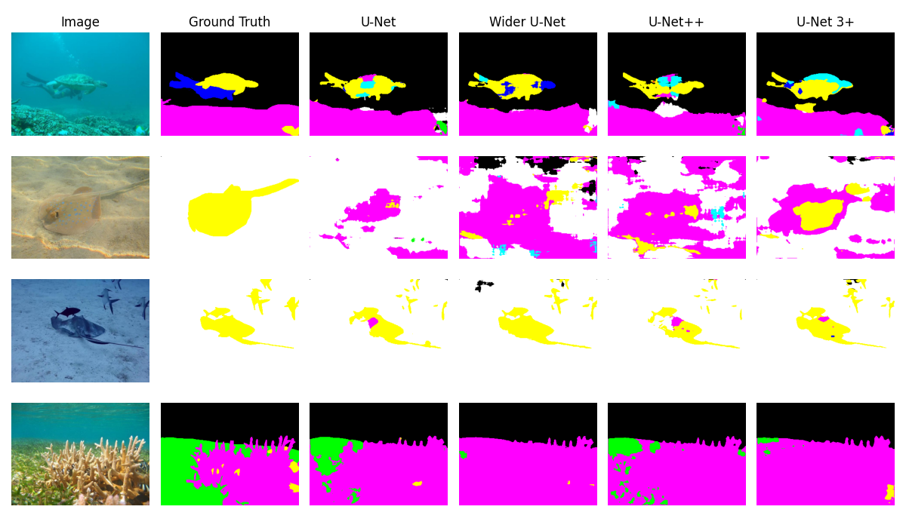
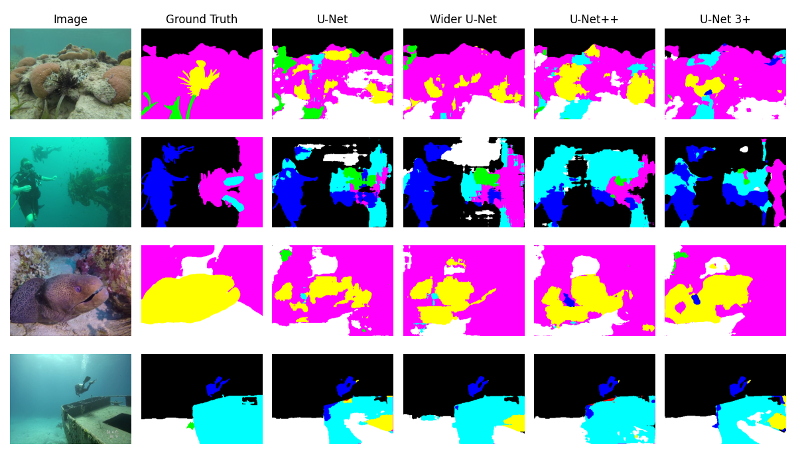

